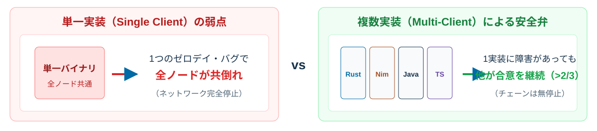
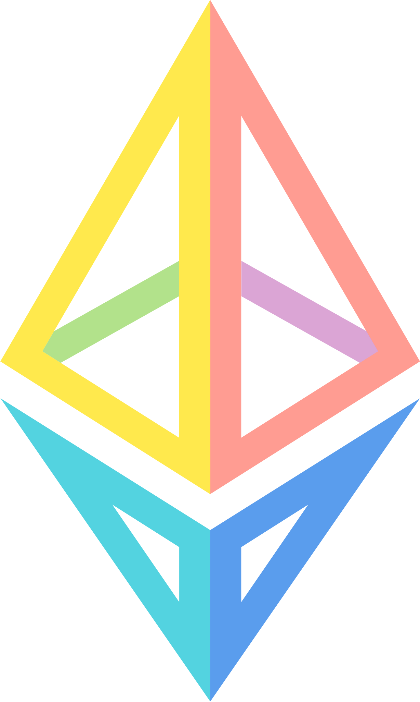
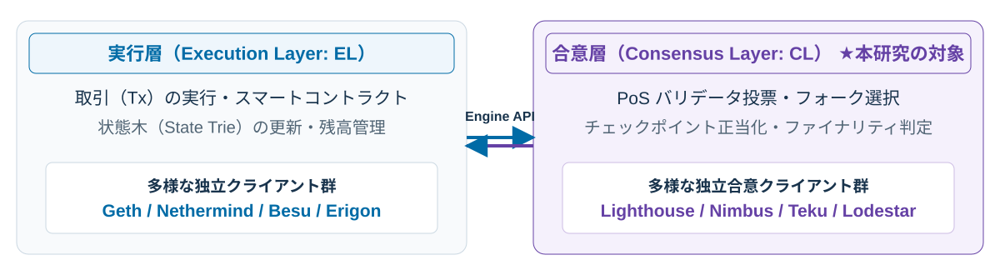
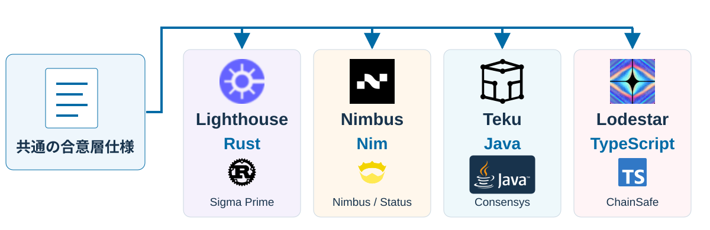
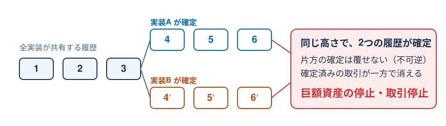
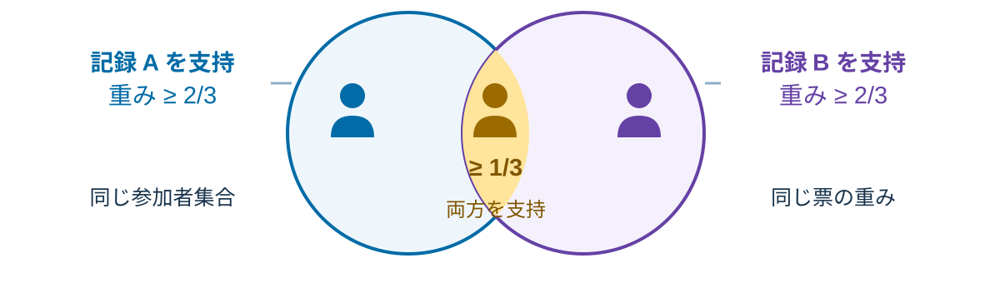
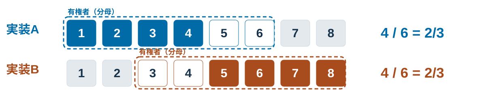
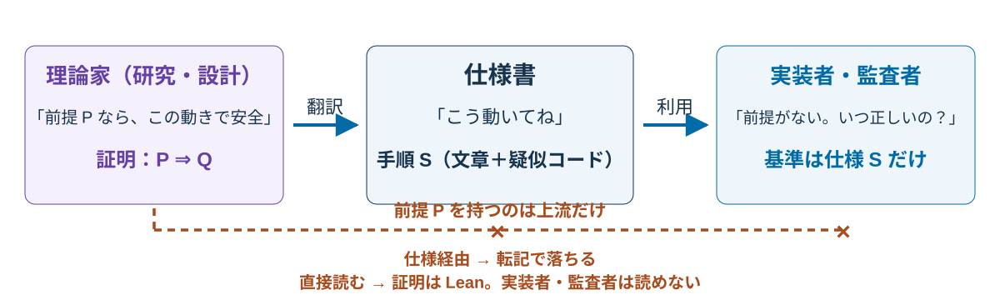
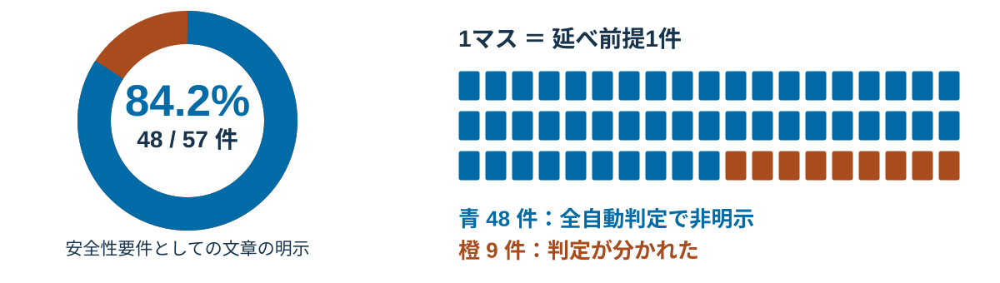
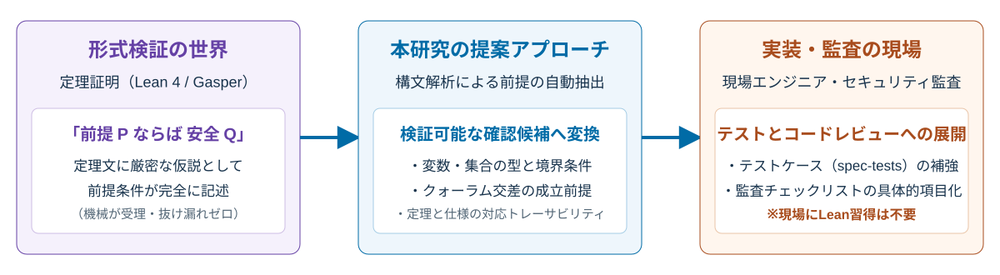

<div class="cover">
<p class="eyebrow">CSS2026 / BWS ブロックチェーンワークショップ</p>
<h1>仕様どおりに実装すれば<br>安全か</h1>
<p class="subtitle">イーサリアムのコンセンサス仕様に明示されない<br>安全性の前提条件（予備調査）</p>
<p class="authors"><strong>村上 大岳</strong>（愛知総合工科高校）<br>神波 真聖・柳浜 万里（Nyx Foundation）<br>釘宮 由成（Independent Researcher）</p>
<p class="cover-claim">安全性の証明から前提を取り出し、確認項目にする。</p>
<p class="agenda-line">背景 ── 従来の問題点 ── 仮説 ── この研究の優位性</p>
</div>

Note:
村上です。
本日は、イーサリアムを例に、共通仕様から作られる複数のソフトの確認方法をお話しします。
研究の提案は、安全性の証明から前提を取り出して、仕様を読むだけでは拾いにくい確認項目を補うことです。
背景、従来の問題点、仮説、この研究の優位性の順で話します。

---

<p class="section-tag">背景</p>

## 「同じ仕様書」なのに、動きが違う

<p>ブロックチェーンの話の前に、エンジニアなら見覚えのある状況から始めます。</p>

<p class="label">例：身近な「仕様 × 複数実装」</p>
<table>
<thead><tr><th>分野</th><th>共通の仕様</th><th>複数の実装</th><th>ズレた所</th></tr></thead>
<tbody>
<tr><td>ブラウザ</td><td>HTML/JSの仕様</td><td>Chrome・Firefox・<strong>Safari</strong></td><td>Safariだけ表示がずれる</td></tr>
<tr><td>Cコンパイラ</td><td>言語規格</td><td>GCC・Clang・MSVC</td><td>未定義動作・拡張で結果が違う</td></tr>
<tr><td>SQL</td><td>標準SQL</td><td>MySQL・PostgreSQL・SQLite</td><td>方言があり、移植すると壊れる</td></tr>
</tbody>
</table>
<p class="message">書いてある所のズレはテストで潰せる。<mark>残るのは、書いていない所</mark>。<br>── もしこのズレが、<strong>資産を扱う基盤</strong>で起きたら？</p>

Note:
まず身近な例から入ります。ブラウザ、Cコンパイラ、SQL。どれも共通の仕様や規格があって、複数の実装がある。
そして「仕様どおりに書いたはずなのに、片方でだけ動かない」という経験は、たいていのエンジニアが持っているはずです。
大事なのは、ズレが出る場所です。仕様に明確に書いてある部分は各実装とも正しく作られます。
ズレが生まれるのは、仕様が書いていない部分、つまり解釈の余地や暗黙の前提があるところです。
では、このズレが資産を扱う基盤で起きたらどうなるか。次のスライドから、実際の対象であるイーサリアムを見ます。

---

<p class="section-tag">背景</p>

## 「だったら実装を1つに統一すれば？」


<p class="takeaway" style="margin-top: 12px; padding: 10px 18px; font-size: 24px;">多様性そのものが安全機構。ただし<strong>「共通の前提」が共有されていなければ、多様性は機能しない。</strong></p>
<p class="message" style="margin: 12px 0 6px; font-size: 26px;">前提は研究者の間では共有済み。届いていないのは<strong>実装者・監査者</strong>。</p>

Note:
「環境差なんて普通だ、公式バイナリを出せばいい」という反論は当然で、実際Bitcoinはその方式で動いています。ただ単一実装は単一障害点でもあります。
アップグレードの過渡期は新旧バージョンがネットワークに同居する、事実上の複数実装状態です。
Bitcoinも2013年、バージョン間のルール差でチェーンが分裂する事故を経験しています。
Ethereumはあえて実装の多様性を安全機構にしました。1つの実装にバグがあっても、それだけでは過半数を取れず、誤った確定を防げる。
ただしこの安全弁には条件があります。全実装が「共通の前提」を共有していることです。
ここで重要なのは、その前提が「どこにもない」のではなく「一部にだけある」ことです。前提は研究者の間では共有されています——安全性の証明の中に正確に書かれている。
届いていないのは実装者と監査者です。専門言語の中に留まった資産が現場に橋渡しされていない、この断絶が今日の主題です。

---

<p class="section-tag">背景</p>

## イーサリアムについて

<div class="brand-lockup"><h3>Ethereum：実行層と合意層の分離アーキテクチャ</h3></div>

<p class="takeaway" style="margin-top: 10px; padding: 10px 18px; font-size: 24px;">世界中の独立ノードが<strong>単一の合意プロトコル仕様</strong>を実装・実行。合意層のわずかな解釈差が<strong>チェーン分裂</strong>に直結する。</p>
<p class="source" style="margin-top: 8px;">アーキテクチャ解説：<a href="https://ethereum.org/en/developers/docs/nodes-and-clients/">ethereum.org</a> ／ 公式Ethereumロゴ：<a href="https://ethereum.org/en/assets/">brand assets</a></p>

Note:
イーサリアムは、世界中の独立した参加者が運用するコンピュータで、取引やプログラムの実行結果を共有する分散基盤です。
トランザクションを実行する実行層（EL）と、Proof-of-Stakeの合意を担う合意層（CL）が明確に分離されています。
本研究が対象とするのは、右側の合意層です。
合意層では、Lighthouse, Nimbus, Teku, Lodestarといった複数の独立したクライアントが、単一の合意仕様書（consensus-specs）に基づいて実装されています。
もし仕様の解釈や暗黙の前提にわずかでも食い違いがあれば、ブロックの確定結果が分裂し、システム全体の停止や資産の損失につながります。
だからこそ、合意仕様の厳密性と、暗黙の前提がどこに存在するかを把握することが極めて重要になります。

---

<p class="section-tag">背景</p>

## そもそも仕様書って、どうできてるの？

<p>具体例：<strong>参加者の投票で「確かな履歴」を全員同じ結果に決める</strong>システムの仕様書。</p>

<div class="grid">
<div class="panel"><p class="label">システムがやること</p><p>① 参加者は「この履歴が正しい」と投票し続ける<br>② 約6.4分（エポック）ごとに全員が同じ手順で集計<br>③ <strong>総支持の2/3超</strong>で「確かな履歴」にマーク</p></div>
<div class="panel"><p class="label">仕様書ではこう書いてある（実物抜粋）</p><div class="proof-code tight"><div>class Checkpoint(Container):  <span class="muted">#「確かな履歴」＝時刻＋指紋</span></div><div>justification_bits: Bitvector[4]  <span class="muted"># 確定判定の履歴</span></div><div>def process_epoch(state):  <span class="muted"># エポックごとの集計</span></div></div><p class="small">型・フィールド・関数まで定義した、実行可能な疑似コード級の詳細設計。</p></div>
</div>
<p class="message">全チームが<strong>この同じ文書を読んで</strong>、実装を書く。</p>
<p class="source">ethereum/consensus-specs（公開・版管理）。抜粋はbeacon-chain.mdの定義の簡略化。</p>

Note:
具体例として、参加者の投票で「確かな履歴」を全員同じ結果に決めるシステムを見ます。
左の手順——参加者が投票し続け、約6.4分ごとに全員が同じ手順で集計し、総支持の3分の2超で確かな履歴にマークする——これがこのシステムのやることです。
右が実物の抜粋です。
「確かな履歴」はCheckpointという型で、時刻と履歴の指紋の組。
集計はprocess_epochという関数。
確定判定の履歴はjustification_bitsという4ビットのフィールドで、これはのちの実例にも繋がるので覚えておいてください。
このように仕様書は、型・フィールド名・更新手順まで疑似コードで定義した、極めて詳細な文書です。
実行も可能で、仕様から生成されるテストデータが各実装の検査に使われます。
全チームがこの一つの文書を読んで実装を書きます。
次の図でその関係を見ます。

---

<p class="section-tag">背景</p>

## 厳密なのは「手順」。「いつ安全か」は書いていない

<p>「疑似コードまで書かれた仕様なら、ズレないのでは？」<br>——厳密に定義されているのは<strong>どう動くか</strong>。抜けているのは<strong>いつ正しいか</strong>。</p>

<div class="grid">
<div class="panel"><p class="label">仕様が定義するもの</p><p>型・フィールド・更新手順<br>実行可能な疑似コード<br>→ <strong>「どう動くか」（HOW）</strong></p></div>
<div class="panel"><p class="label">仕様に書いていないもの</p><p>その手順が安全に機能する条件<br>想定している状況・適用範囲<br>→ <strong>「いつ正しいか」（WHEN）</strong></p></div>
</div>
<p class="message">＝ <strong>doc に事前条件のない関数</strong>を、<br>各チームが読んで実装している状態。</p>
<p class="small">コードは正確に読める。でも「この前提を満たさない呼び出しは無効」という契約が書かれていない——あの感覚です。</p>

Note:
「疑似コードまである詳細な仕様なら、ズレようがないのでは？」と思われるかもしれません。実際、仕様書は「どう動くか」については極めて厳密です。
型も手順も実行できるほど詳細に書いてあります。
でも、ソフトウェアでいう「この関数の事前条件は何か」——その手順がいつ安全に機能するかという契約は、仕様には書かれていません。
実装経験があれば分かると思いますが、コード自体は完璧に読めても、「callerはnullを渡してはいけない」「このリストはソート済み前提」という条件がdocに無い関数は、
読み手ごとに前提の補い方が変わります。
全実装がまさにその状態にあります。
その「書いていない前提」がどこにあるか、実際の例で見ていきます。次の図では、この共通仕様から複数の実装がどう作られるかを見ます。

---

<p class="section-tag">背景</p>

## 一つの共通仕様から、別々のソフトが作られる

<p>実装者は<strong>仕様書を読んでコードを書く</strong>。別々の言語の実装が、同じネットワークで動く。</p>

<p class="message">共通仕様をもとに、独立した実装が共存する<strong>多実装環境</strong>。</p>
<p class="source">合意を担当する4実装を例示。このソフトをクライアントと呼ぶ。実装・言語ロゴは公式素材（出典・権利者は補足と <code>figs/logo-sources.json</code>）。</p>

Note:
たとえば、RustのLighthouse、NimのNimbus、JavaのTeku、TypeScriptのLodestarがあります。
上がソフトのロゴ、言語名の下が言語のロゴです。
開発の形は、共通の仕様書を読んで、それぞれのチームが自分の言語でコードを書く、というものです。
こうして作られた実装が、同じネットワークに参加します。
「1つのC++コアを各言語でラップすればいいのでは？」という疑問は当然です。
あえて独立チーム・別言語でフルスクラッチするのは、1つのゼロデイやコンパイラバグで全実装が共倒れするのを防ぐためです。
N-version programming、多様性そのものが安全機構です。
これを多実装環境と呼びます。
今回のクライアントという語は、このネットワークを動かすソフトです。
そこで開発者や監査者は、何を基準に別々の実装を確認するのでしょうか。
その前に——ずれると、なぜまずいのかを先に見ます。

---

<p class="section-tag">背景</p>

## 「食い違い」は、なぜ特別に危険なのか

<p style="margin: 6px 0 10px;">普通のソフトのバグは「利用者の問題」。ここで壊れるのは、<strong>「全員が同じ履歴を持つ」という合意そのもの</strong>。</p>

<p class="takeaway" style="margin-top: 10px; padding: 10px 18px; font-size: 24px;">各実装が「仕様どおり」に動くだけでは不十分。<strong>暗黙前提のわずかなズレが、不可逆なチェーン分裂を引き起こす。</strong></p>
<p class="small" style="margin-top: 6px;">「分裂し得る」と分類された修正は実際に公開されている——後の実例で紹介。</p>

Note:
先に「なぜこれが大事か」を言います。
普通のソフトのバグは、そのソフトを使う人だけが困ります。
ところがコンセンサス実装のずれは別格です。
この基盤が売っている商品は「全員が同じ履歴を持つこと」、つまり一致そのものだからです。
もし実装AとBが、それぞれ別の履歴を「確定」、つまり覆せないと記録したら、履歴は二つに裂けます。
確定済みのはずの取引が一方で消え、担保を預けた参加者の資産も危険にさらされます。
言い換えれば、数兆円が消し飛び得る話です。
実際に「分裂し得る」と分類された修正は公開されており、後で実例を見ます。
つまり「全部の実装が本当に同じ判断をするか」は、品質管理の範囲を超えた、基盤の存亡の問題です。
では人々は何で揃えているのか——次に監査の出発点を見ます。

---

<p class="section-tag">背景</p>

## 開発・監査の出発点は、共通の仕様書

<p>実際の仕様書の抜粋。<strong>どの入力で、どの状態をどう更新するか</strong>が書かれている。<br>
文脈：約6.4分ごとの集計処理の中で、<strong>票の支持が厚い履歴を「確か」とマークする</strong>部分。</p>

```python
if previous_epoch_target_balance * 3 >= total_active_balance * 2:
    #   「前の期間に集まった支持の重み」×3  ≧  「有権者全員の重み」×2
    #   = 支持が全体の 2/3 以上か？ という判定（×3・×2 は分数の整数化）
    state.current_justified_checkpoint = Checkpoint(
        epoch=previous_epoch, root=get_block_root(state, previous_epoch)
    )
    state.justification_bits[1] = 0b1   # 「正当化した」という履歴を4bitに記録
```

<p class="source">原典：<a href="https://github.com/ethereum/consensus-specs/blob/2359a5e/specs/phase0/beacon-chain.md#justification-and-finalization">consensus-specs @ 2359a5e</a>。このコードは票の支持を状態に反映する部分。EIP-3675 はこの詳細仕様を参照する。</p>

Note:
合意を担当するソフトの詳細仕様は、consensus-specsという公開文書です。
文章と、処理を定義するPythonのコードからなります。
開発者はこの疑似コードを読んで、RustやNimなど自分の言語で同じ処理を書きます。
なお1行目の「支持する重み×3 ≥ 総重み×2」が、あの「2/3の支持」の判定です。
×3と×2は、分数の3分の2を整数だけで比較するための書き方です。
変数名を覚える必要はありませんが、このように数値はコードにあるのに、「どの状態のどの集合を数えているか」は行の中に名前がありません。
そして最終行で更新している justification_bits こそが、のちの実例で出てくる Nimbus #461 がずらした状態そのものです。
覚えておくと繋がります。
仕様から要求された処理を列挙し、各実装がそのとおり動くか確認する。
これが今の標準的なやり方です。
ここで当然、「仕様に忠実に準拠していれば十分ではないか？」という疑問が湧きます。次でその理由をお話しします。
その疑問は正しく、そして重要です。
次で応えます。

---

<p class="section-tag">従来の問題点</p>

## 「分かる」と「書いていない」は、別の層

<p>さきほどの式を読み解くと、<strong>2つの層</strong>に分かれます。</p>

<div class="grid">
<div class="panel"><p class="label">仕様書で「分かる」もの</p><p>×3 ≧ ×2 という計算・更新手順<br>変数が何を指すか（定義を辿れば追える）<br>→ <strong>手順と意味は書いてある</strong></p></div>
<div class="panel"><p class="label">仕様書のどこにも「書いていない」もの</p><p>この判定が<strong>いつ安全に効くか</strong>——<br>どの名簿・どの分岐状況・どんな出席率を<br>想定した保証か、という<strong>前提条件</strong><br>→ <mark>文章のどこにも出てこない</mark></p></div>
</div>
<p class="small">「よく読めば分かる」「仕様に書き足せばいい」——どちらも正しい。<br>
ただし仕様書をいくら精読しても、文章に無い前提は出てきません。書き足すにも「何を書くか」の確かな一覧が必要。<br>
抜け漏れなしの一覧は<strong>証明の中にだけ</strong>ある。</p>

<p class="small">監査の確認項目は<strong>仕様の文章から作られる</strong>。書かれていない条件は誰が見る？</p>

Note:
さきほどの式は写せます。変数の中身も、仕様書の中で定義を辿れば追えます。ここは正直に言います、意味は書いてあるんです。
書いていないのはその先です。
この判定がいつ安全に効くのか——どの名簿を数え、どんな分岐状況・出席率を想定した保証なのかという前提条件は、仕様書のどこにも出てきません。
前後をいくら読んでも見つからない。それが証明の仮説にだけ書かれています。
「仕様書をよく読めばいい」「じゃあ仕様にその前提を書き足せばいい」——どちらも方向は正しいです。ただ仕様書をいくら精読しても、文章に無いものは出てきません。
そして書き足す側にも、何を書くべきかの確かな一覧はありません。散文の書き足しはもう一度の翻訳で、設計から仕様への翻訳で前提が落ちたのと同じ漏れが起きます。
抜け漏れなしの一覧は証明の中にだけあります。
仕様から要求された処理を列挙し、各実装がそのとおり動くか確認する。これが今の標準的なやり方です。
では、なぜ仕様に準拠しているだけでは防げないのか。次のスライドでその構造を説明します。

---

<p class="section-tag">従来の問題点</p>

## 「仕様に準拠すれば良い」のでは？

<p>その通り——<strong>全チームがそうしています</strong>。<br>問題は単なる「準拠ミス」にとどまらず、同じ記述でも解釈が分かれてしまう点にあります。</p>

<div class="grid">
<div class="panel"><p class="label">ふつうの層：手順の記述</p><p>仕様が「この操作をこうする」と具体的<br>ずれる ＝ <strong>誰かのミス</strong><br>→ レビュー・テストで見つかる</p></div>
<div class="panel"><p class="label">今回の層：条件の記述（数学に近い）</p><p>「〜の2/3」「その時点の〜」と条件を書く<br>ずれる ＝ <strong>別々の妥当な読み</strong><br>→ 全員「仕様準拠」なのに結果が違う</p></div>
</div>

<p class="message">「どの解釈が正しいか」は、<strong>仕様の文章だけでは裁定できない</strong>。</p>
<p class="small">Cの規格にも未定義動作はあるが、「どの集合を数えるか」が実装ごとに分かれる種類のずれは、手順が具体的な層では起きにくい。</p>

Note:
「仕様書どおりに実装すれば十分ではないか」——その通りであり、世界中の全開発チームが実際にそうしています。
「仕様書に準拠すれば良いのでは？」——正しい。
そして全チームが実際にそうしています。
問題は「仕様を守っていない」ことではありません。
実装のずれには二つの層があります。
手順の層では、仕様が「この操作をこうする」と具体的に書くので、ずれは誰かのミスで、レビューやテストで見つかります。
C言語のような普通の実装ではほとんどこれです。
もう一つは数学に近い層です。
「〜の2/3」「その時点の〜」という条件文は、何を指すかを読む人が決めます。
複数チームがそれぞれ妥当そうに読むと、全員が仕様準拠なのに結果が違う——手順の記述では起きにくい、記述のスタイルに依存した失敗モードです。
Cの規格にも未定義動作はありますが、「どの集合を数えるか」が実装ごとに分かれる種類のずれは、手順が具体的な層ではあまり起きません。
そして、どの解釈が正しいかは仕様の文章だけでは決められません。
では、なぜそのような解釈のズレが致命的なのか、次に数学的な定理の構造を見ます。

---

<p class="section-tag">従来の問題点</p>

## 安全性の核心：クォーラム交差の前提

<p style="margin: 6px 0 10px;">「仕様どおり」なのに結果が分かれる理由：合意仕様は<strong>数学的な安全性定理（クォーラム交差）</strong>に依存している。</p>

<p class="takeaway" style="margin-top: 10px; padding: 10px 18px; font-size: 24px;">定理は「同じ参加者集合・同じ重み」を前提に安全を保証。<strong>この前提が仕様の文章に書かれていなければ、各実装で解釈が分かれてしまう。</strong></p>
<p class="small" style="margin-top: 6px;">どれだけ算術（2/3）を正しく実装しても、前提が満たされなければ安全性は保証されない。</p>

Note:
合意仕様の安全性を支えているのは、クォーラム交差という数学的定理です。
全体の3分の2以上の支持を集めた決定が2つあれば、全体の集合が100%である限り、少なくとも3分の1は両方を支持する参加者が重複、つまり交差します。
これによって「同時に2つの異なる履歴が確定することはない」という安全性が保証されます。
しかし、この定理が成り立つためには「同じ参加者集合（名簿）を分母とし、同じ票の重みで計算している」という絶対的な前提が必要です。
仕様書には「2/3以上の支持」という計算手順は書かれていても、「どの参加者集合を分母とすべきか」という前提条件は書かれていません。
前提が共有されていなければ、各実装が仕様どおりに2/3を計算しても、交差は保証されず、安全性の保証そのものが崩壊します。
では、その条件は監査で見えているのでしょうか。
次に見ます。

---

<p class="section-tag">従来の問題点</p>

## 問題の入口：確認できるのは、仕様に出たものだけ

<p>さきほどの確認の流れをもう一度見る。<br>確認項目は<strong>仕様の文章から列挙する</strong>——つまり、こうなる：</p>

<div class="flow">
<div class="panel"><h3>仕様に書いてある</h3><p>手順・計算・状態の更新</p><p class="actor">→ 確認項目になる。誰かが見る</p></div>
<div class="arrow">vs</div>
<div class="panel"><h3>仕様に書いていない</h3><p>前提・適用条件・表現の限界</p><p class="actor">→ 項目にならない。誰も見ない</p></div>
</div>
<p class="message">計算が正しく書かれていても、その<strong>前提</strong>が文章に出ていなければ、<br><strong>監査チェックリストの「行」にすら載らない。</strong></p>
<p class="small">では実際に、文章に出ていない条件はあるのか——次は具体例です。</p>

Note:
前のスライドでは「同じ記述を別々に読む」ずれを見ました。
では監査では何が見えているのか——さきほどの確認の流れをもう一度見ます。
確認項目は仕様の文章から作られるので、文章に書いてあるものは項目になり、誰かが見ます。
一方、文章に書いていないものは項目にならず、結果として誰も見ません。
つまりこの確認方法には、「文章に出たものだけが見える」という見え方の限界があります。
もし正しさに必要な条件が文章に出ていなかったら、その条件は監査の対象にすらなりません。
では実際に、仕様に出ていない条件はあるのでしょうか。
次に具体的な例を二つ見ます——一つは仮想例、もう一つは実際に起きた修正です。

---

<p class="section-tag">従来の問題点</p>

## 「2/3」は合っている。でも、何の2/3か？

<p>仕様：「総重みの2/3が支持すれば、<strong>正当化</strong>＝確かとみなす」<br>→　監査：「2/3の計算があるか」　→　コードは2/3（算術記述の一致を確認）</p>
<p class="small">コードが書くのは「名簿の計算手順」。<strong>その計算が安全を保証する前提（どの集合関係・どんな出席を想定したか）</strong>は書いていない。<br>同じ手順を写しても、<strong>前提の共有が崩れれば同じ方向に間違える</strong>。</p>
<p class="label">仮想例（説明用）：8人・等しい重みで集計（色付き＝支持、白＝対象内で非支持、灰＝対象外）</p>

<p class="message">両方とも4/6 ＝ 2/3。でも母集団が違えば、<strong>同じ保証は使えない。</strong></p>

Note:
監査で拾われない理由を先に示します。
仕様は「総重みの2/3が支持すれば、その履歴を正当化＝確かとみなす」と書いています。
重みはバリデータが預けた担保の量で、正当化の先には、もう覆せないとみなす「確定」があります。
監査の確認は「2/3の計算があるか」になります。
コードを見れば2/3の算術は仕様どおりに実装されており、表面上の検査は通過します。
ところが、その2/3は何を数えた2/3なのでしょうか。
名簿の計算手順は疑似コードに書いてあります。
でも「誰が有権者か」は登録名簿で決まり、名簿はエポック毎に変動し、分岐中は枝ごとに別の名簿が存在します。
どの集合・どんな出席を想定した保証なのかという前提は、コードにも散文にも書かれていません。
だから全実装が同じ手順を写しても、前提の共有が崩れれば同じ方向に間違えます。
差分テストでは拾えないズレです。
仮想例では、実装Aは1番から6番、実装Bは3番から8番を対象にしています。
どちらも4人を6人で割れば2/3ですが、母集団が違うので同じ保証は使えません。
そしてこのずれは、実際に起きています。
次に実例を見ます。

---

<p class="section-tag">従来の問題点</p>

## 実例：計算は合った。でも状態がずれた

<p class="small">※前提の非明示が直接の原因とは示していない。<strong>同じ処理領域の修正の重大さを示す動機づけの例</strong>。</p>
<p class="label">表面的な検査で確認されたこと</p>
<p>「2/3の計算があるか」→ 仕様どおりの閾値計算を実装コード内で確認</p>
<p class="label">実際に起きたフォーク要因（Nimbus PR #461の実例）</p>
<div class="bitstrip"><span class="bitname">justification_bits</span><div class="bit">1</div><div class="bit">0</div><div class="bit stale">0</div><div class="bit stale">1</div><span class="stale-label">← 4bit境界の型制約の不整合</span></div>
<p>正当化履歴を保持する4bitビットベクトルの更新時、暗黙のマスク処理が漏れて上位ビットが残留し、<strong>確定（Finality）判定の状態不一致</strong>が発生。<br>公開脆弱性DB（ethereum-vuln-dataset）では<strong>チェーン分裂（chain split）に至る深刻度</strong>と分類。</p>
<p class="message">算術記述は仕様どおり。問題は<strong>計算に渡す状態表現の暗黙前提</strong>にあった。</p>
<p class="source">Nimbus PR #461（公開・修正済、ethereum-vuln-dataset の impact_type=chain_split）。ずれた状態は、先ほどの仕様抜粋の最終行 justification_bits。</p>

Note:
監査が見たのは「2/3の計算があるか」で、コードには確かに2/3の算術式が存在していました。
しかし実際に起きたのは、計算に渡す状態データの境界における不整合です。
Nimbusの修正#461は、正当化履歴を保持する4ビット、justification_bitsの更新で上位ビットが残り、確定判定に使う状態がずれた実バグです。
このjustification_bitsは、先ほどの仕様抜粋の最終行で更新していた状態そのものです。
公開データセットではチェーン分岐に至り得ると分類されています。
重要なのは、算術の計算式自体が誤っていたわけではなく、型境界や状態更新の暗黙の前提がコードと仕様の間で共有されていなかった点です。
なお前提の非明示がこのバグの原因だったとは示していません。
データセットの分類ラベルが同じ処理領域に位置するという、位置的な共起関係の例示です。
分母のずれも、状態のずれも、仕様の手順記述の外側にある「前提条件」に起因します。
では、なぜその条件は仕様書を読むだけでは見えないのでしょうか。
仕様が作られる構造に目を向けます。

---

<p class="section-tag">従来の問題点</p>

## なぜ、仕様を読むだけでは見えないのか


<p class="message"><strong>構造的ギャップ：</strong>仕様書が示すのは「実行手順（HOW）」であり、<br>安全性を保証する「前提条件（WHEN）」は<strong>形式証明の中にのみ存在している</strong>。</p>
<p class="small">「証明」＝「この条件を満たせば保証が必ず成り立つ」を<strong>機械が検算</strong>した文書（Lean）。<br><strong>機械が受理した時点で、仮説に抜け漏れはない</strong>——書くべき前提の確かな一覧は証明の中にだけある。</p>
<p class="source">図は説明用の模式図。設計の安全性議論はCasper FFG・Gasper等の研究に、仕様はconsensus-specs（EIP）に存在。証明の機械化がgasper-lean4。</p>

Note:
ここまでの二つの例——分母のずれと、計算に渡す状態のずれ——は、どちらも仕様の手順には出ていない条件の話でした。
では、なぜその条件は仕様から見えないのでしょうか。
これは仕様書の欠陥というより、仕様書と証明の「役割分担」に起因する構造的ギャップです。
先に理論家による研究と設計があり、そこには安全性の証明、つまり「この前提が満たされるとき、安全性が成立する（WHEN）」という数学的議論が存在します。
その設計を、各ノードが実行可能な状態遷移手順（HOW）へと書き下したものが仕様書です。
実装者はこの手順に従ってコードを書き、監査者はこの手順を基準に確認します。
しかし、安全性を保証するための前提条件（WHEN）は証明側にのみ保持されており、仕様書の手順記述の中には現れません。
さらに、証明はLeanという形式言語で記述されているため、現場の実装者や監査者が直接読み解くことも困難です。
ならば、証明の中に厳密に存在する前提条件を機械的に抽出し、現場が確認できる「チェック候補」として届ければよい。
これが本研究の提案アプローチです。

---

<p class="section-tag">仮説</p>

## 仕様どおりの実装は、証明の前提まで満たさない

<p>証明は<mark>保証書</mark>と同じ構造。条件内は保証、<strong>条件外は対象外</strong>。</p>

<div class="route"><span>問題</span><strong>同じ「仕様どおり」でも、前提が満たされるかは仕様を読むだけでは区別がつかない</strong></div>
<div class="route"><span>仮説</span><strong>前提には、仕様に書かれていないものがある</strong></div>
<div class="route"><span>提案</span><strong>証明から取り出して、確認項目として渡す</strong></div>
<div class="route"><span>その先</span><strong>監査者・実装者が前提まで確認 → ずれを早く摘み、履歴の分裂と資産損失を減らす</strong></div>
<p class="source">図は説明用の模式図。Lean＝証明を機械が検査する言語。入力：Ethereumの安全性をLean 4で形式化した <strong>gasper-lean4 の証明</strong>。</p>

Note:
ここまでで問題が見えました。
仕様書を読んで、そのとおり実装するだけでは不十分です。
なぜなら仕様書は「こう動け」という手順を教えますが、「証明が要求する前提を、あなたの実装が満たしているか」は教えてくれないからです。
前提が満たされるかは、仕様には証明できません。
証明は保証書と同じ構造です。
「決められた条件で使うなら、これを保証する」と書いてある。
条件の外では保証は効きませんが、「必ず壊れる」とも書いていません。
図は、仕様に従う実装の中で、前提を満たす領域にだけ保証が効くことを示しています。
そしてその境界は、仕様の手順には書かれていません。
なお形式証明とは、条件から結論への導出を機械が検査したものです。
仕様の文章からしか確認項目を作らなければ、文章に現れない前提は拾いにくくなります。
そこで、安全性の証明をもう一つの入力にします。
証明は「この条件なら、この結論」という形で、必要な前提を持っています。
本研究の提案は、その前提を取り出し、実装や運用の確認に使える候補へ変換することです。
本研究の目的は、形式証明を書くこと自体にとどまらず、証明が要求する前提を現場へ届ける点にあります。
最後の行は、その先に何が起きるかです。
監査者と実装者は、仕様の手順だけでなく証明が要求する前提まで確認できるようになります。
確認できるものが増えれば、実装間のずれを早く摘め、履歴の分裂と資産損失を減らせます。
直接うれしいのは監査者・実装者のように確認する側の人たちで、その結果として使う人、ネットワーク、利用者の資産が守られる話です。

---

<p class="section-tag">提案</p>

## 足すのは「証明 → 前提 → 確認候補」の経路

<p>証明の中の「前提」という資産が、Leanの中に留まったまま。<br><strong>理論家の成果をエンジニアへ橋渡しし、有効性を試した。</strong></p>

<div class="route"><span>従来の入力</span><strong>仕様の記述 → 確認項目</strong></div>
<div class="flow extraction-flow">
<div class="panel purple"><h3>安全性の証明</h3><p>条件 ⇒ 保証</p><p class="actor">理論家の成果</p></div>
<div class="arrow">→</div>
<div class="panel"><h3>前提を抽出</h3><p><strong>定理の前提を列挙</strong></p><p class="actor">構文的・LLM不使用</p></div>
<div class="arrow">→</div>
<div class="panel blue"><h3>確認候補へ変換</h3><p>仕様・コードと対応付け</p><p class="actor">研究側が翻訳</p></div>
</div>
<p class="message">証明の専門家だけの成果を、<strong>実装者・監査者が参照できる前提一覧</strong>にする。</p>
<p class="small">実装者・監査者はLeanを読まず、<strong>翻訳済みの一覧を受け取る</strong>。抽出した条件には原典の定理への参照を残す。</p>

Note:
従来の、仕様から項目を作る経路を捨てるのではありません。
証明から前提を列挙する経路を追加します。
なお、実装者や監査者がLeanを読む必要はありません。
抽出と翻訳は研究側が済ませ、現場が受け取るのは日本語の前提一覧です。
理論家に新しいコードや文書を書かせる提案でもありません。
前提は証明の中に既に正確に書かれています。
やることは、その翻訳です。
本研究ではLean 4で形式化された成果を使います。
その定理の仮説を機械的に取り出し、原典と照合しました。
抽出した条件には、元の定理の参照も残します。
なお抽出はAIの生成ではありません。
定理文の型シグネチャに並ぶ仮説を、Leanの構文として決定的に読み取る処理です。
言い換えれば、コロンの手前に並んだ括弧を列挙するだけで、解釈や生成を挟みません。
だから捏造が起きません。
LLMが登場するのは、後段の「明示か」の判定の側だけです。
その後、意味と仕様の参照先を対応付けて、監査者が参照できる確認候補へ変換します。
次に、どの部分を取り出すのかを実例で示します。
なお証明の価値は正しさだけではありません。
定理を成立させるには仮説をすべて記述する必要があるため、前提の一覧は人が選んだ恣意的な目録と異なり、構造上抜け漏れのない完全な一覧になります。
形式言語なので言い換えの揺れもありません。

---

<p class="section-tag">提案</p>

## 提案手法のスコープ：何をして、何をしていないか

<p>「要は、仕様に足りない情報を証明から足して、確認項目はAIに作らせる話？」<br>半分正しいです。<strong>どこを機械化し、どこを信用しないか</strong>が設計の要点です。</p>

<table>
<thead><tr><th>工程</th><th>方法</th><th>なぜそうするか</th></tr></thead>
<tbody>
<tr><td>前提の抽出</td><td><strong>機械的・LLM不使用</strong></td><td>生成させると、証明に存在しない前提が混ざる。定理文の構文を読むだけなら捏造が起きない</td></tr>
<tr><td>仕様への明示判定</td><td><strong>LLM＋照合器（複数）</strong></td><td>文章の言い換えを機械だけでは拾えない。ただし判定は一致度であり正解ラベルではない</td></tr>
<tr><td>確認候補の実効性</td><td><strong>未検証</strong></td><td>監査で実際にバグを拾えるかは、まだ示していない（正直な限界）</td></tr>
</tbody>
</table>
<p class="message">証明からの一次情報だけは人の翻訳に委ねず、<br><strong>抜け漏れなくそろった一覧を出す</strong>のが貢献です。</p>

Note:
「要するに、仕様に足りない情報を証明から補っているだけでは？」と思われるかもしれません。実際、その通りです。
本質は、仕様と証明の間にある前提のギャップを、一覧として埋めることにあります。
「確認項目はAIに作らせればいいのでは」——半分正しいです。明示の判定にはLLMを使っています。ただし抽出の側はあえてAIを使いません。
生成モデルに前提を書かせると、証明に無い前提まで自信たっぷりに足します。定理の仮説は構文を機械的に読めば決定的に取れるので、捏造の入る余地をなくしました。
そして限界も明記します。出した確認候補が実際の監査でバグを拾えるかは、まだ評価していません。
今回示せるのは「仕様の文章に明示されていない前提が、証明の中に定量的に存在する」ことまでです。

---

<p class="section-tag">提案</p>

## 実例：定理に書かれた「条件」の部分を取り出す

<div class="grid" style="margin-bottom: 10px;">
<div><h3 style="margin: 0 0 8px;">定理文の、コロンの手前を抜き出す</h3><div class="proof-code tight" style="padding: 8px 12px; font-size: 15px;"><div class="muted">theorem quorum_intersection_weight_lower</div><div class="muted">　{ qL qR vL vR : … }  -- 部品（除外）</div><div>　( hqLsub : <mark>qL ⊆ vL</mark> )</div><div>　( hqRsub : <mark>qR ⊆ vR</mark> )</div><div>　( hqLwt : <mark>τ.two_third (wt stake vL) ≤ wt stake qL</mark> )</div><div>　( hqRwt : <mark>τ.two_third (wt stake vR) ≤ wt stake qR</mark> )</div><div class="muted">　: 結論（保証）</div></div><p class="small" style="margin: 4px 0 0; font-size: 18px;">括弧群＝前提（Leanでは仮説）。構文的に列挙し実体条件を選別。</p></div>
<div class="premise-list"><h3 style="margin: 0 0 8px;">取り出される前提の意味</h3><div class="premise" style="padding: 6px 10px; margin-bottom: 6px; font-size: 20px;"><p style="margin: 0;"><strong>① 参加者集合の包含：</strong><br>支持した参加者が、その側の集計対象に含まれる。</p></div><div class="premise" style="padding: 6px 10px; margin-bottom: 6px; font-size: 20px;"><p style="margin: 0;"><strong>② クォーラムの重み閾値：</strong><br>その対象の総重みに対して、2/3以上の重みが支持する。</p></div><p class="small" style="margin: 4px 0 0; font-size: 18px;">この条件を、<strong>両側（フォーク双方）</strong>で満たす必要がある。</p></div>
</div>
<p class="message" style="margin: 10px 0 6px; font-size: 28px;">「2/3」という数字だけでなく、<br><strong>どの参加者集合・どの重みを使うか</strong>まで前提に含まれる。</p>
<p class="source" style="margin-top: 6px;">原典：<a href="https://github.com/NyxFoundation/gasper-lean4/blob/7650709/GasperBeaconChain/Core/Theories/SlashableBound.lean">quorum_intersection_weight_lower / gasper-lean4 @ 7650709</a>。原ソースの仮説4式を示す。日本語は説明用の要約。</p>

Note:
左側の記号や数式は細かく読む必要はありません。要点は右側の日本語2行です。「支持した人が名簿に入っているか」「全体の2/3以上いるか」。言っていることはこの2点だけです。
どうやって証明から降ってくるかを見せます。
定理文は「theorem 名前（仮説）（仮説）…：結論」という形をしています。
コロンの手前の括弧が、定理が依存する前提です。
ツールはこれをLeanの構文として読み、型やモデルの部品（波括弧の引数）を除いた実体条件だけを選別します。
解釈も生成も挟まない決定的な処理で、何度やっても同じ一覧が出ます。
今回は8ファイル17定理から延べ57件が出ました。
この例では、左側と右側それぞれについて、支持した参加者が集計対象に含まれること、その集計対象の総重みに対して3分の2以上が支持していることを要求しています。
記号を覚える必要はなく、右の意味を見てください。
「誰を数えるか」「何を分母とするか」まで含む条件を、証明の側から取り出せます。
この定理は、集計対象の重なりに応じて、支持者の重なりを評価します。
両側の参加者集合が同一であることを常に要求する定理ではありません。
異なる場合の保証も、その関係を含めて評価するため、先ほどの仮想例と矛盾しません。

---

<p class="section-tag">提案</p>

## 前提を、監査で扱える確認候補へ変換する

<div class="grid tl">
<div><p class="label">人が読む形（確認一覧）</p><table>
<thead><tr><th>取り出した条件</th><th>確認候補（例）</th></tr></thead>
<tbody>
<tr><td>支持者が集計対象に含まれる</td><td>票の出所と参加者集合が対応しているか。</td></tr>
<tr><td>対象の総重みの2/3以上が支持</td><td>分母と分子の重みを、どの状態から計算しているか。</td></tr>
<tr><td>集合の関係に応じて保証を評価</td><td>参加者の入れ替わり時に、どの集合・重みをモデル化しているか。</td></tr>
</tbody>
</table></div>
<div><p class="label">ツールが読む形（SPECA等の入力）</p><pre class="json-snippet"><code class="language-json">{
 "property_id": "CHK-GEN-09",
 "severity": "CRITICAL",
 "lean_status": "descends-from-proved",
 "lean_artifact": "AccountableSafety.lean#…",
 "spec_reference": "beacon-chain.md#…",
 "lean_must_establish": [
  "¬ q_intersection_slashed …",
  "k_finalized …", "justified …" ]
}</code></pre></div>
</div>
<p class="message">人には<strong>確認一覧</strong>、監査ツールには<strong>JSON</strong>を渡す。<br>どちらも、条件・原典の定理・仕様の参照先がつながっている。</p>
<p class="small">右は実際の成果物形式（実データ）。左の対応付けは使い方の例で、バグ検出性能は別途検証する。</p>

Note:
機械抽出して終わりではなく、その条件が仕様や実装のどこに対応するかを示します。
右側のJSONは人間が読むためのものではなく、監査ツールや自動テストへ渡すためのデータ形式です。現場のエンジニアが確認するのは左側の日本語一覧表だけで十分であり、Leanの学習コストを強いることはありません。
画面左は、先ほどの前提を実務で確認するならどんな問いになるか、という使い方の例です。
画面右は実際に渡される成果物の形です。
プロパティID、重要度、由来した定理、対応する仕様の箇所、前提条件がJSONでまとまっています。
ただし監査者が素のJSONを読むわけではなく、これはSPECAのような監査パイプラインが次段（コード位置特定・検査）へ渡す入力形式です。
人が読むのは左の確認一覧で、どちらもLeanを読む必要はありません。
「descends-from-proved」という状態も大事です。
これは「項目文そのものが証明済み」という意味ではなく、「証明済みの定理から機械変換で降りてきた」という来歴を記録したものです。
なお proved を含むラベルは「この項目が検証済み」と誤読され得るため、より明示的な命名（例：derived-unverified）への変更は妥当な指摘です。項目自体の検証は別途行う、という設計です。
重要度は仕様書の記述量ではなく安全性定理の構造に由来するため、仕様に書かれていない前提でも優先度が落ちない設計になっています。
研究の出力は、前提条件と、その来歴となる定理、対応する仕様箇所を持つ項目一覧です。
こうした項目が全部で27あり、そのうち17項目が前提条件を持ち、残る10項目は追加の前提を要さないものです。
左列の具体的なレビュー手順を自動生成し、その効果を評価したわけではありません。
候補を利用する人は、意味を確認して、コードのチェックなのか、モデル・運用条件の確認なのかを割り当てます。
この候補が、仕様の文章だけから得る項目とどれだけ異なるかを調べました。

---

<p class="section-tag">仮説の検証</p>

## 抽出した前提は、仕様に明示されているか

<div class="flow">
<div class="panel purple"><span class="number">17</span><h3>対象の定理</h3><p class="small">定理ごとに仮説を列挙<br>原典と照合</p></div>
<div class="arrow">-></div>
<div class="panel"><span class="number">57</span><h3>延べ前提条件</h3><p class="small">複数の条件を対応付け<br>同一概念の反復を含む</p></div>
<div class="arrow">-></div>
<div class="panel blue"><span class="number">89</span><h3>仕様ファイル</h3><p class="small">文章の安全性要件と照合</p></div>
</div>
<div class="grid"><div class="panel"><h3>前提の抽出</h3><p>証明の仮説から機械的に列挙。<br>LLMで自由生成しない。</p></div><div class="panel"><h3>明示の判定</h3><p>キーワード照合器と6種類のLLM。<br>仕様の文章に等価な安全性要件があるか。<br>操作的に書かれた要件も「明示」と判定。</p></div></div>
<p class="source">gasper-lean4 @ 7650709 / consensus-specs @ 2359a5e。57は重複を含む延べ件数。</p>

Note:
調査では17の定理に由来する延べ57件の前提条件を対象に、89の仕様ファイルを照合しました。
なお形式化全体は25定理・11ファイルで、そのうち確認項目を導出した17定理・8ファイルが今回の対象です。
前提を取り出す段階は機械的な抽出です。
一方、仕様の文章に安全性要件として等価な記述があるかの判定は、キーワード照合器と6種類のLLMによる自動判定です。
抽出と判定は別の段階です。
判定の問いは「厳密に同一の数学記述があるか」ではなく「同じ安全性要件が文章として存在するか」です。
操作的な手順として書かれた要件は明示に数えます。
それでも、形式述語に対して自然言語の仕様を問う設計自体に非明示方向のバイアスが残り得る点は、限界として認識しておいてください。
なお、ここで評価に関する注意点を明確にしておきます。
これから出てくる一致は「判定器どうしの一致」であって、正解との一致ではありません。
人手の正解ラベルとの照合はまだ実施しておらず、7つが同じ方向に間違える可能性は排除できていません。
57は原典の仮説行を単純に数えた総和でも、独立した57種類でもなく、確認項目に対応付けた前提一覧の延べ件数です。
結果を見ます。

---

<p class="section-tag">この研究の優位性</p>

## 10概念中7概念は、仕様の文章に非明示と判定


<div class="route"><span>具体例</span><strong>証明の中心概念は仕様側で別名に分散（supermajority等）——用語レベルでも断絶</strong></div>
<p class="message">仕様からの項目作りだけでは、<br><strong>証明の前提を拾いきれない可能性</strong>を示した。</p>
<p class="small">延べ57件中48件（84.2%）が非明示。「明示」と全員一致した条件は0件。<br>同一前提が多定理で繰り返し要求される＝<strong>根幹を支える急所</strong>の裏付け。実装のバグ数ではない。</p>

Note:
主な数字は10概念中7概念です。
延べ57件中48件、84.2パーセントが、すべての自動判定で「文章に安全性要件として明示されていない」と判定されました。
橙の9件は判定が分かれたもので、明示と数えていません。
逆に、全員が「明示されている」と同意した条件は0件でした。
割れた3概念はjustified・finalized・votes_from_target_vset_propertyです。
いずれも仕様書がstate.current_justified_checkpointなど明示的な状態として持つ対象で、「状態の明示」と「安全性要件としての明示」の境界で解釈が割れました。
同じ概念の反復をまとめると10概念で、うち7概念が非明示で一致しました。
「57件」は重複を含む延べ数です。ただし同じ前提が多数の定理で繰り返し要求されていること自体、それらが合意形成の根幹を支える急所である裏付けでもあります。
ユニークな概念の数を問われたら、10概念中7概念と答えてください。
コードや状態に対応物があっても、文章に安全性要件として書かれていない場合を含みます。
象徴的なのは、証明の中心概念が仕様側ではsupermajorityやtotal_active_balanceといった別名に分散していることです。
quorumという単語の有無そのもの以上に、理論側の前提と仕様書の記述との間に、用語レベルでの断絶が存在する構造こそが重要です。
これは48個のバグを見つけた結果ではありません。
仕様の文章だけを入力にする確認項目作りには、証明の前提を拾いきれない可能性がある、という研究結果です。
つまり、証明からの抽出は従来の経路では得られない確認候補を供給できます。
これが本研究の優位性です。
なお「仕様に自然言語で書けばよい」は、まさに従来がやって拾いきれなかった方法です。
書くべき内容の一次情報として証明を使うことが、この研究の出発点です。

---

<p class="section-tag">適用の一例</p>

## 前提を確認する領域に、実際の修正もある

<p class="small">次は、集計結果を保存する状態の扱い。<strong>Nimbus #461</strong>：4ビットの履歴に余分な桁が残る。</p>
<div class="grid">
<div class="panel orange"><div class="label">修正前 / PR差分</div><pre><code class="language-nim">state.justification_bits =
  state.justification_bits shl 1</code></pre><p>左へずらすだけ。</p><p class="small"><code>1000 → 10000</code></p></div>
<div class="panel blue"><div class="label">修正後 / PR差分</div><pre><code class="language-nim">const JUSTIFICATION_BITS_LENGTH = 4
state.justification_bits =
  (state.justification_bits shl 1) and
  cast[uint8](
    (2^JUSTIFICATION_BITS_LENGTH) - 1)</code></pre><p class="small">下位4ビットだけ残す。<br><code>1000 → 0000</code></p></div>
</div>
<p class="message">計算手順に加え、<strong>状態の表現範囲</strong>も確認する。</p>
<p class="source"><a href="https://github.com/status-im/nimbus-eth2/pull/461/files">Nimbus PR #461</a>（2019年、改行のみ調整）。同一ラベルへの位置的共起のみで、因果は主張しない。</p>

Note:
抽出した確認候補の一部は、過去に修正があった処理領域にも対応します。
ここではNimbusの公開済み修正を示します。
4ビットの履歴を整数で表していましたが、左シフトした後に4ビットの外へ情報が残ります。
修正は、下位4ビットだけを残すマスクの追加でした。
なお、この事例は因果関係を直接立証するものではなく、同一の処理領域で事故が起きていたという動機づけの一例です。
根拠はデータセットの分類ラベルが一致するという位置的な共起だけで、同じコードパスを通るという確認まではしていません。
さらに確認項目自体が過去バグの分布を参照して合成されているため、この共起は一部、作り方に由来する産物でもあります。
先ほどの前提の違いの仮想例がこのバグを引き起こしたという話でもありません。
研究が当該バグを再検出できることも未評価です。

---

<p class="section-tag">実務への展開</p>

## 前提ごとに「誰が何を確認するか」を決める

<p>ここからは次の行動。<strong>取り出した前提を、仕様・コードへ対応付け、<br>担当と確認方法を割り当てる</strong>。</p>

<div class="grid">
<div class="panel blue"><h3>実装で確認する</h3><p>票の出所と集計対象の対応。<br>総重み・支持重みの計算。<br>状態の表現範囲。</p><p class="small">コード・テスト・レビューへ。</p></div>
<div class="panel purple"><h3>モデル・環境として確認する</h3><p>参加者の入れ替わり。<br>想定する違反者の規模。<br>どの条件下の保証を使うか。</p><p class="small">設計・運用・証明の適用範囲へ。</p></div>
</div>
<p class="message"><strong>すべての前提を単一のassertに変換するわけではありません。</strong><br>条件の意味に応じて、確認の責任と手法を正しく割り当てます。</p>

Note:
取り出した前提には、実装で保つ条件と、モデルや環境についての仮定が含まれます。
すべてをassertに置き換えるのではありません。
票と集計対象の対応や、計算、状態の表現範囲はコードに結び付けられます。
一方、攻撃者がどれだけの重みを持つかは、関数のassertで確立するものではありません。
前提一覧を受け取ったら、意味と担当、確認方法を決める。
この分担が、証明から得た条件を実務で使うために必要です。
なお「現場への丸投げでは」という指摘にはこう答えます。渡すのは生の前提の羅列ではなく、分類（実装が担う条件か、環境・モデルの仮定か）・重要度・定理参照・仕様アンカーを同梱した項目です。現場に残る作業は分析ではなく割当です。組織ごとに担当の決め方が違う以上、割当自体を機械化することは本質的にできません。

---

<p class="section-tag">実務への展開</p>

## 実装者：前提をテスト・レビューへ落とす

<div class="grid">
<div class="panel"><h3>例：集計の分母は前提で名指しされた集合か</h3><p>証明から取り出した仮説を、<br>そのまま不変条件にする。</p><p class="small">Leanの仮説 <code>q ⊆ v</code>・<code>2/3·wt(v) ≤ wt(q)</code> と1対1。<br>どの定理由来かをコメントに残す。</p></div>
<div class="panel blue"><div class="label">提案するテスト例 / 関数名は仮・実現可能性の実演</div><pre><code class="language-python">def test_denominator(state, epoch):
    v = validators(state, epoch)
    tally = tally(state, epoch)
    # 前提: q ⊆ v
    assert tally.voters &lt;= set(v)
    # 前提: 2/3·wt(v) ≤ wt(q)
    assert 3 * tally.wt &gt;= 2 * total_wt(v)</code></pre></div>
</div>
<p class="message">前提 → 対応する状態・処理 → テスト／レビュー。</p>

Note:
実装者向けの使い方の例です。証明から取り出した仮説を、そのまま不変条件のテストに落とします。
右のテストは説明用で、関数名は仮のものです。
先ほどのLean定理の仮説「支持者が集計対象に含まれる」「対象の総重みの3分の2以上が支持」と1対1に対応しています。
つまり形式証明の前提が、現場のユニットテストや不変条件のアサーションとして機能します。
このように条件を確認方法へつなげます。
複雑なモデルの仮定はテストだけで扱えないため、レビューや設計確認へ割り当てます。
本研究では、これによる監査性能の改善はまだ評価していません。

---

<p class="section-tag">実務への展開</p>

## 仕様を書く人：対応表は仕様の外に置く

<table>
<thead><tr><th>記すもの</th><th>投票集計を例にした記述案</th></tr></thead>
<tbody>
<tr><td><strong>手順</strong></td><td>支持する重みを集計し、閾値と比較する。</td></tr>
<tr><td><strong>対象・状態の前提</strong></td><td>どの参加者集合を対象に、どの状態の総重みを分母に使うかを参照できるようにする。</td></tr>
<tr><td><strong>保証との接続</strong></td><td>仕様本文は手順に留め、証明・モデルとの対応表を<strong>別成果物</strong>として置く。</td></tr>
<tr><td><strong>環境の仮定</strong></td><td>参加者の入れ替わりや攻撃者の規模を、実装の処理要件とは区別して記す。</td></tr>
</tbody>
</table>
<p class="message">実装者が<strong>「何を・どこで・どう確認するか」</strong>をたどれる仕様へ。</p>

Note:
仕様を書く人への提案は、前提と手順の対応をたどれるようにすることです。
投票を集計するなら、対象の参加者集合と分母に使う状態も分かる形にします。
保証を説明する証明やモデルがあるなら、その前提と仕様箇所を接続します。
ただし仕様書の散文に学術注釈を埋め込む話ではありません。
仕様本文は手順に留め、前提への参照は隣に置く対応表が担います。関心の分離はそのままです。
一方、攻撃者の規模などの環境の仮定は、実装が確立する処理要件とは区別します。
すべての前提を仕様の処理手順に押し込むのではなく、実装者が必要な確認をたどれるようにする提案です。
「仕様に分かりやすく書けばいい」は本提案と同じ方向です。
違いは、何を書くかの出所を証明の仮説に置く点です。
機械が検査した一次情報を土台にすれば、書き手の記憶や解釈に頼りません。

---

<p class="section-tag">実務への展開</p>

## 共通仕様から作る、他のシステムでも考えられる

<div class="grid three">
<div class="panel"><h3>分散合意<br>Raft / Paxos</h3><p>メンバーシップ動的変更</p><p class="hypothesis"><strong>確認候補：</strong><br>新旧構成の共存期でも、<br>クォーラム交差の前提が<br>満たされているか。</p></div>
<div class="panel"><h3>BFT合意<br>Tendermint 等</h3><p>有権者集合の動的変動</p><p class="hypothesis"><strong>確認候補：</strong><br>各エポックでアクティブな<br>有権者集合の定義が<br>全実装で一致しているか。</p></div>
<div class="panel"><h3>分散プロトコル<br>形式仕様モデル</h3><p>ネットワーク環境前提</p><p class="hypothesis"><strong>確認候補：</strong><br>部分同期性や通信順序の<br>数学的前提がコードの<br>仮定と合致しているか。</p></div>
</div>
<p class="message">「共通仕様＋独立した複数実装」を持つシステム全般で、<strong>証明の前提を抽出する枠組み</strong>が有効。</p>
<p class="source">単一仕様とマルチクライアント構成を持つ分散システム一般への適用可能性の考察。</p>

Note:
この三つは、本アプローチが適用可能な分散システム一般の例です。
Raftなどの分散合意プロトコルでも、メンバーシップ変更の過渡期におけるクォーラム交差条件など、証明側で要求される前提と実装時の手順との間にギャップが生じ得ます。
BFT系プロトコルにおける有権者集合の変動や、ネットワークの遅延・同期性の前提条件も同様です。
単一の共通仕様に基づいて複数の開発チームが独立に実装を行うアーキテクチャでは、どのシステムでも「手順の記述」と「安全性の数学的前提」の乖離がリスクとなります。
本研究が提案する「証明の前提条件を機械抽出し、実装・監査のチェック項目へ渡す」枠組みは、イーサリアムに限らず、安全性が最重要視される分散システム全般に拡張可能です。

---

<p class="section-tag">まとめ</p>

## 証明の成果を、現場が参照できる形へ


<p class="takeaway" style="margin-top: 10px; padding: 12px 18px; font-size: 24px;"><strong>形式手法の成果を現場の実務へ還元：</strong>現場のエンジニア全員がLeanを習得する必要はありません。前提条件の自動抽出が、研究と実装・監査をつなぐインターフェースになります。</p>
<p class="source" style="margin-top: 8px;">提案アーキテクチャ：定理証明（Lean 4）からテスト・監査チェックリストへの前提条件抽出パイプライン</p>

Note:
前提抽出の意義は、証明の成果を専門家だけが読むものにしないことです。
現場の人全員にLeanを勉強してもらう、という提案ではありません。
受け取るのは、条件と、その条件の来歴である定理、対応する仕様の参照先です。
それを自分の実装や運用に対応付け、誰がどう確認するかを決めます。
本研究が示したのは、この前提を供給する経路と、仕様の文章との照合結果です。
下流の監査への効果は次の検証課題です。
その検証は具体的に計画しています。過去の実バグに対する項目の再演（回帰的検証）と、判定の人手正解ラベルとの照合です。抽象的な「今後の課題」ではなく、ethereum-vuln-datasetの既知バグに対して候補が検出に寄与するかを試す形です。

---

<p class="section-tag">まとめ</p>

## まとめ：安全性の証明から、前提を取り出そう

<p class="summary">仕様を読むだけの確認に、<br>証明が要求する前提を足す。</p>
<div class="grid three">
<div class="panel"><h3>提案</h3><p>定理の前提を機械抽出し、<br>確認候補へ変換する。</p></div>
<div class="panel blue"><h3>調査結果</h3><p>延べ57件中48件は、<br>仕様の文章に非明示と判定。</p></div>
<div class="panel"><h3>次の行動</h3><p>前提を仕様・コードへ対応付け、<br>担当と確認方法を決める。</p></div>
</div>
<p class="small">今後：人手の正解ラベルによる検証、実バグを見ずに作った項目での再検出実験、他のBFT系への展開。　ご清聴ありがとうございました。</p>

Note:
まとめます。
研究の中心は、安全性の証明から前提を取り出し、仕様に基づく確認を補うことです。
対象の証明から延べ57件の条件を抽出・対応付け、48件が仕様の文章に安全性要件として明示されていないと自動判定されました。
前提の一覧を、仕様やコードのどこで確認するかにつなげる。
これが現場で使うための次の行動です。
今後は、著者から独立した人手の正解ラベルによる判定の検証、実バグを一切参照せずに作った項目で修正前のバグを再検出できるかの小実験、そしてTendermintやHotStuffといった他のBFT系への横展開を予定しています。
ご清聴ありがとうございました。

---

<p class="section-tag">補足</p>

## 補足：仮想例は、何を示しているか

<table>
<thead><tr><th></th><th>集計対象</th><th>支持者</th><th>対象に対する割合</th></tr></thead>
<tbody><tr><td>実装A</td><td>1, 2, 3, 4, 5, 6</td><td>1, 2, 3, 4</td><td>4/6 = 2/3</td></tr><tr><td>実装B</td><td>3, 4, 5, 6, 7, 8</td><td>5, 6, 7, 8</td><td>4/6 = 2/3</td></tr></tbody>
</table>
<p>支持者の重なりは0人。全8人に対しては、両方とも4/8。</p>
<div class="panel"><p>同じ全体を使う場合の「重なりは1/3以上」という直感を、<br>違う分母の集計に無条件で適用できない。</p></div>
<p class="small">集計部分を切り出した仮想例。この対象選択が仕様に準拠するとも主張していない。Ethereumの確定には投票間の関係・状態更新・検証など追加の条件があり、実ネットワークの事故を再現していない。</p>

Note:
仮想例は、2/3の計算だけでは、全体の定義や参加者の入れ替わりを確認できないことを示します。
異なる集合を使うこと自体が常に違反なのではありません。
原典の定理は異なる参加者集合も扱い、集合の交差に応じた下限を与えます。
この例の集計対象は4人で重なりますが、支持者は0人で重なります。
その場合に1/3の重なりを無条件に期待することが誤りです。

---

<p class="section-tag">補足</p>

## 補足：原典の定理と、抽出する仮説

<table>
<thead><tr><th>定理・補題</th><th>保証の意味</th></tr></thead>
<tbody>
<tr><td><code>quorum_intersection_weight_lower</code></td><td>二つの支持者集合の重なりを、参加者集合の重なりと閾値から下側に評価する。本編の抽出例。</td></tr>
<tr><td><code>k_safety'</code></td><td>両立しない履歴が確定したなら、二つの支持集合の交差がモデル上の違反判定の対象になる。</td></tr>
<tr><td><code>slashable_bound</code></td><td>違反判定対象の重みを、参加者の入れ替わりも含めて下側に評価する。</td></tr>
<tr><td><code>no_k_finalized_justified_same_height</code></td><td>指定した前提のもとで、確定した記録と別の支持された記録は同じ高さに並ばない。CHK-GEN-09の母定理。</td></tr>
</tbody>
</table>
<p class="source">gasper-lean4 @ 7650709。確定を支える投票ルールは Casper FFG と呼ばれる。定理の成立と、実装・現実へのモデルの適用は区別する。</p>

Note:
本編の例はSlashableBound.leanにある定理の仮説です。
包含の仮説2式、重みの閾値の仮説2式を抜粋しました。
本研究の57件は、確認項目に対応付けたmust-establish一覧の延べ件数であり、原典のすべての仮説行を単純に数えたものではありません。
型・モデルのパラメータ等の部品も区別しています。
安全性の核心を示す定理と、前提の抽出を説明する例の役割を区別してください。
定理を検査するLeanのカーネルが受理しても、モデルが現実を忠実に表すことまで自動的に保証されるわけではありません。

---

<p class="section-tag">補足</p>

## 補足：結果の意味と、まだ評価していないこと

<div class="grid">
<div class="panel"><h3>測ったこと</h3><p>証明由来の前提が、<br>仕様の文章に安全性要件として<br>明示されているか。</p></div>
<div class="panel orange"><h3>まだ測っていないこと</h3><p>実装のバグ数。<br>追加項目のバグ検出性能。<br>他分野でも同じ割合になるか。</p></div>
</div>
<p class="small">延べ57件・10概念。48件（7概念）は非明示に一致、9件は判定が分かれた。判定器はすべて自動で、正式な人手評価は今後の課題。判定器間の一致率は0.913（PABAK 0.826）だが、判定器「間」の一致であって正解との一致ではない。判定器の設計者は著者であり利益相反も否定できない。</p>
<p class="small">非明示は「コードにも存在しない」とは限らない。前提には実装で保つ条件、脅威モデルの仮定、証明の補助条件が含まれる。仕様には安全性の帰結を非形式に述べる文書（弱件性・高速確定）はあるが、分解された前提を検査可能な要件としては与えていない。</p>

Note:
結果は、自動判定による仕様の文章との照合です。
同じ概念の反復があるため、独立した57種類の安全性要件ではありません。
判定器間の一致率は0.913、偶然を補正したPABAKでも0.826ですが、あくまで判定器どうしの一致であり、正解ラベルとの一致ではありません。
キーワード照合器の設計者は著者自身なので、利益相反も否定できません。
独立した6モデルの併用は部分的な緩和にとどまります。
また、仕様に安全性の概念が一切ないわけではありません。
弱件性の文書には「相反するチェックポイントが確定すれば攻撃者は最低3分の1没収される」という帰結が、高速確定の文書には脅威モデルの閾値が非形式で述べられています。
非明示が意味するのは、証明が要求する分解された前提が、検査可能な要件として与えられていない、ということです。
仕様に非明示であることは、実装に脆弱性があることや、仕様の誤りを直接証明しません。
下流の監査に役立つかは、正式な人手判定やバグの再検出実験で確認する必要があります。

---

<p class="section-tag">補足</p>

## 補足：同じ処理領域にあることと、同じ原因は別

<div class="grid">
<div class="panel"><h3>Nimbus #461</h3><p>正当化履歴のビット処理を修正。<br>下位4ビットを残すマスクを追加。</p></div>
<div class="panel"><h3>Lighthouse #4576</h3><p>確定に伴うデータ移行で、<br>同じロックを二度取得する<br>デッドロックを修正。<span class="small">※並行処理バグで別種</span></p></div>
</div>
<p class="message">一部項目と実バグは同じ分類領域へ対応付けられる。<br>ただし領域の一致は「同じ種類のバグ」を意味しない。</p>
<p class="small">対応はデータセットの分類ラベルに基づく。コードパスの一致や、前提の非明示がバグを生んだという因果は示していない。前提の違いの仮想例とも別の話。</p>
<p class="source"><a href="https://github.com/status-im/nimbus-eth2/pull/461">Nimbus #461</a> ／ <a href="https://github.com/sigp/lighthouse/pull/4576">Lighthouse #4576</a></p>

Note:
この対応付けで示せるのは、同じ分類領域に位置することです。
二つの修正は原因も障害クラスも違います。
Nimbusはビット表現の処理、Lighthouseはデータ移行のロック処理です。
LighthouseのデッドロックはOSの同期プリミティブの並行処理バグであり、合意の安全性前提とは無関係です。
同じ処理領域に実バグが起きているという動機づけ以上の意味はありません。
抽出した項目がこれらのバグを検出できたかは未評価です。
仮想例を、これらの事故の原因説明として使っていません。

---

<p class="section-tag">補足</p>

## 想定される反論と答え

<table>
<thead><tr><th>反論</th><th>答え</th></tr></thead>
<tbody>
<tr><td>「単一実装なのに『実装差』は概念破綻」</td><td>2013年のBDB事故は0.7系と0.8系が<strong>同時にネットワークを走った</strong>事案。アップグレードの過渡期は事実上の複数実装状態で、「異なるルールブックのノードが同居してチェーンが裂けた」構造は本題と同型。</td></tr>
<tr><td>「理想化された前提は現場を救えない」</td><td>「1/3未満のビザンチン」「部分同期」はまさに<strong>運用で監視すべき環境前提</strong>。保証が効かない条件を現場が把握していなければ、クライアント集中リスクの警告も意味をなさない。既存の堅牢化の代替ではなく補完。</td></tr>
<tr><td>「差分ファジングで解決」</td><td>差分ファジングが見つけるのは<strong>実装間の不一致</strong>。全実装が同じ見えない前提を共有して同じ方向に間違える<strong>common-mode failure</strong>は検出できない。「正解」のオラクルは証明の前提が担う。併用するもので代替ではない。</td></tr>
<tr><td>「仕様書は手順書。前提が無いのは自明」</td><td>問題は「書かれていないこと」ではなく<strong>「確認項目の原料がどこにも無いこと」</strong>。仕様から監査項目を作る以上、そこに無い前提は検査されない。辞書の文法証明と違い、クォーラム交差の前提は実装の正当性に必須の事前契約。</td></tr>
</tbody>
</table>

Note:
想定される反論に先回りして答えます。
一つ目、単一実装に実装差は概念破綻という指摘。2013年の事故はバージョン間の非互換で、新旧クライアントが同居した事実上の複数実装状態です。
二つ目、理論の前提は理想化しすぎという指摘。だからこそ、その前提は運用で監視すべき項目です。保証が効かない条件を把握できないことが問題です。
メモリリークなどの障害は本研究の対象外で、既存対策の補完です。
三つ目、差分ファジングで解決という指摘。ファジングは実装間の不一致を見つけますが、全実装が同じ前提で同じ方向に間違える場合は検出できません。
四つ目、仕様書は手順書だから前提が無いのは当たり前という指摘。問題は書かれていないこと自体ではなく、監査項目の原料が現場に届かないことです。辞書の文法うんちくと違い、クォーラム交差の前提はシステムが安全に動くための必須の事前契約です。

【質疑カンペ：ここからは自分用。聴衆に読み上げなくてよい】
Q「仕様は手順書。前提が書かれてないのは自明」→ 主張は欠陥ではなく「確認項目の原料が無い」。監査項目は仕様の文章から作られる以上、そこに無い前提はチェックリストの行にならない。spec-tests合格は前提を満たす保証ではない。
Q「判定器のプロンプトが誘導」→ だからこそ一致率は「正解ラベル」ではなく「判定器間の一致度」と論文・スライドで明記。突き止めたのは「仕様書の文章と理論前提の間に、現在の自然言語処理やキーワード照合では埋められない大きな構文的・意味的断絶が存在する」という事実そのもの。
Q「Nimbusはこじつけ」→ 前提漏れが引き起こした因果は主張していない。重要なのは「まさに前提を抽出したその処理領域（justification_bitsの更新）で、実際にチェーン分裂に至る致命的バグが起きていた」という位置的共起の事実。理論的にも実装的にも最も事故が起きやすい「急所」であることが実バグの歴史からも裏付けられている。
Q「現場に丸投げ」→ 現場が一番困るのは「何を気をつければいいか分からない（未知の未知）」状態。本手法はそれを「この定理のこの条件を確認すればいい（既知の課題）」へ変換して渡す。assertか監視アラートかは組織のアーキテクチャ・運用体制で異なるため、確認責任の割当を現場が担うのは健全な「関心の分離」。
Q「前提の選別は主観的」→ 列挙は決定的、選別ルールは人が定義→認める。ルールは文書化・検査可能で項目ごと差し替え可。「明示」全員一致0件は線引きを変えても消えにくい観察。
Q「新バグは1つも見つかってない」→ 本研究はバグ探索ツールではなく「仕様と形式証明の間に生じる84.2%の前提欠落を世界で初めて測定したMeasurement Study」。物理学で言えば新粒子を見つける前に「測定器の目盛りと理論値のズレ」を明らかにした段階。この地図があるからこそ、次のステップで確度の高いバグハントが可能になる。
Q「手動マッピングはスケールしない」→ 対応表は一度作れば差分レビューで済む資産。識別子照合や埋め込み候補提示＋人間承認で段階的自動化可能。上限は形式化カバレッジ。
Q「LLM判定を誰が検証」→ 一致率は正解率ではないと明言。次は人手正解ラベルとの照合。
Q「57件は何の数」→ 重複を含む延べ数。独立要件でもバグ数でもない。概念なら10中7が非明示。
Q「証明自体が間違ってたら」→ 証明は機械検査済み。モデル→現実仕様の忠実性は人間が確認する問題で、アンカー＋ピン留めで第三者検査可能にしている。
Q「quorumが仕様に無いだけでは」→ 単語の有無ではなく、前提がsupermajority等の別名に分散し用語レベルで橋が架かっていない構造の話。
Q「仕様に書き足せばいい」→ 方向は正しい。ただし何を書くかの一次情報が無いと同じ漏れが再発する。証明の仮説は構造上抜け漏れが無い一覧。

---

<p class="section-tag">補足</p>

## 参照資料・イラスト・公式ロゴの出典

<div class="grid">
<div class="panel"><h3>仕様・証明・修正PR</h3><p class="small"><a href="https://github.com/ethereum/consensus-specs/tree/2359a5e">consensus-specs @ 2359a5e</a><br><a href="https://eips.ethereum.org/EIPS/eip-3675">EIP-3675</a><br><a href="https://github.com/NyxFoundation/gasper-lean4/tree/7650709">gasper-lean4 @ 7650709</a><br><a href="https://github.com/status-im/nimbus-eth2/pull/461">Nimbus #461</a> / <a href="https://github.com/sigp/lighthouse/pull/4576">Lighthouse #4576</a></p><p class="small">研究の対象・数値・限界は論文正本に基づく。</p></div>
<div class="panel"><h3>イラスト・ブランド素材</h3><p class="small"><a href="https://ethereum.org/en/assets/">ethereum.org / WT</a><br><a href="https://undraw.co/illustrations">unDraw / Katerina Limpitsouni</a>（<a href="https://undraw.co/license">利用条件</a>）<br><a href="https://github.com/rust-lang/rust-artwork/">Rust Foundation / Rust project</a>（<a href="https://creativecommons.org/licenses/by/4.0/">CC BY 4.0</a>、変更なし）<br><a href="https://github.com/nim-lang/assets">Nim project</a> / <a href="https://dev.java/">Oracle / Java</a><br><a href="https://www.typescriptlang.org/branding/">Microsoft / TypeScript</a></p><p class="small">ロゴは各ブランドの識別用。推薦・提携を示さない。<br>取得元・ハッシュ・利用条件は <code>figs/*-sources.json</code>。</p></div>
</div>

Note:
原典と素材の出典です。
イラストはネットから取得した素材をそのまま使い、数量を示すグラフと仮想例の図は、本発表のデータに基づいています。
Ethereum、実装、言語のロゴは公式サイトまたは公式アートワークから取得しました。
RustはCC BY 4.0で、変更せず使用しています。
各ブランドの推薦や提携を示すものではありません。
