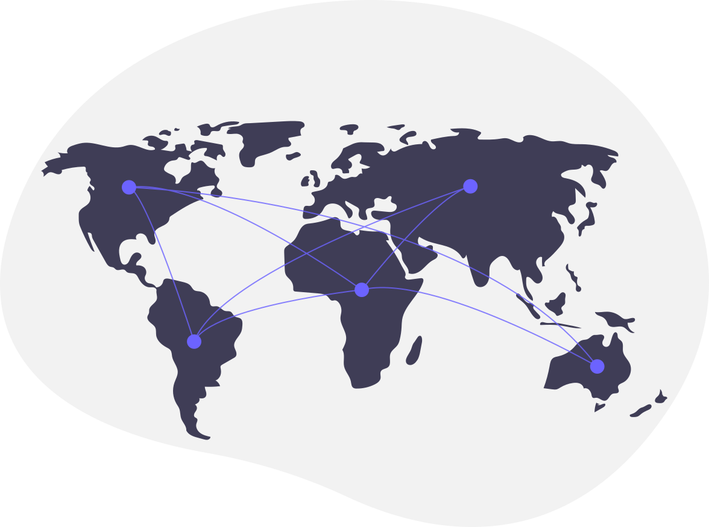
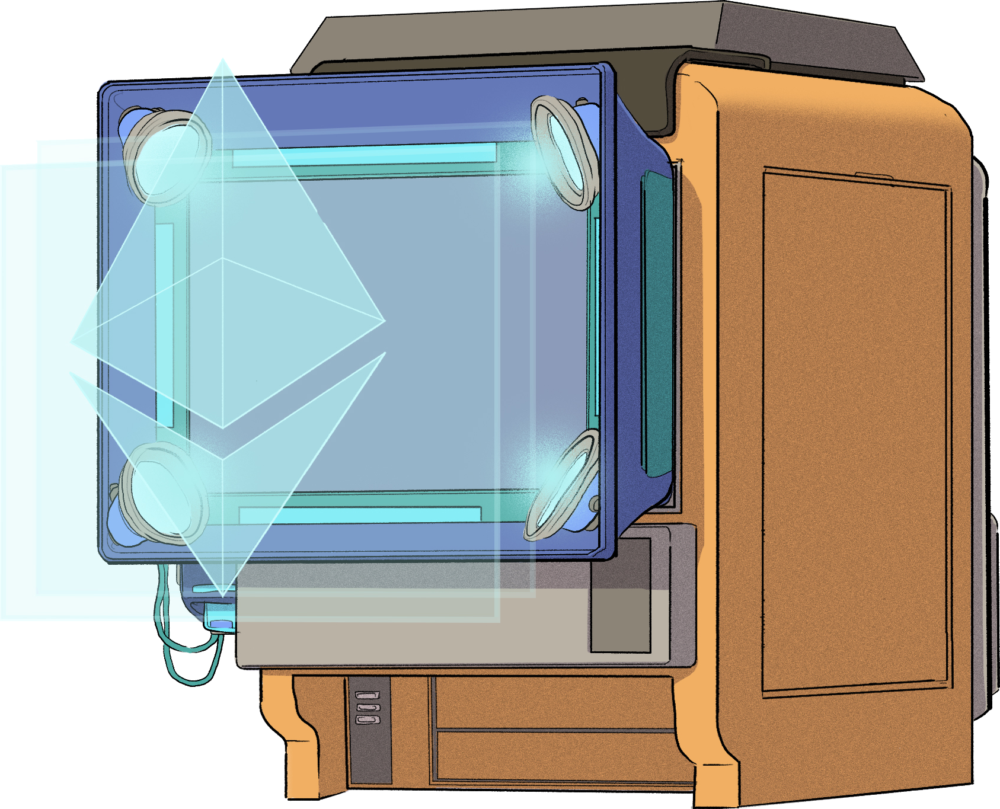

<div class="cover">
<p class="eyebrow">CSS2026 / BWS ブロックチェーンワークショップ</p>
<h1>仕様どおりに実装すれば<br>安全か</h1>
<p class="subtitle">イーサリアムのコンセンサス仕様に明示されない<br>安全性の前提条件（予備調査）</p>
<p class="authors"><strong>村上 大岳</strong>（愛知総合工科高校）<br>神波 真聖・柳浜 万里（Nyx Foundation）<br>釘宮 由成（Independent Researcher）</p>
<p class="cover-claim">安全性の証明から前提を取り出し、確認項目にする。</p>
<p class="agenda-line">背景 ── 従来の問題点 ── 仮説 ── この研究の優位性</p>
</div>

Note:
村上です。
本日は、イーサリアムを例に、共通仕様から作られる複数のソフトの確認方法をお話しします。
研究の提案は、安全性の証明から前提を取り出して、仕様を読むだけでは拾いにくい確認項目を補うことです。
背景、従来の問題点、仮説、この研究の優位性の順で話します。

---

<p class="section-tag">背景</p>

## イーサリアムについて

<div class="visual-story">

<div class="story-copy"><div class="brand-lockup"><h3>Ethereum</h3></div><p class="lead">世界中の第三者が運用する、<br>取引・プログラム実行の基盤。</p><p>全員が<mark>同じ取引履歴</mark>を保存・確認する。<br>管理者ではなく数学に依存。<br>だから、善良な参加者は<br><strong>全員同じ動きをしなければならない。</strong></p></div>
</div>
<p class="source">解説：<a href="https://ethereum.org/en/developers/docs/nodes-and-clients/">ethereum.org</a> ／ 公式Ethereumロゴ：<a href="https://ethereum.org/en/assets/">brand assets</a> ／ イラスト：Katerina Limpitsouni, <a href="https://undraw.co/illustration/connected-world_anke">unDraw</a></p>

Note:
イーサリアムは、世界中の第三者が運用するコンピュータで、取引やプログラムの実行結果を共有する基盤です。
全員が同じ取引履歴を保存し、互いに確認します。
中央の管理者ではなく、数学、つまり計算と経済的な仕組みに依存して動きます。
全員で決めるので、善良な参加者は全員が同じ動きをしなければなりません。
ここで重要なのは、この基盤を動かすソフトが、一つのチームが作った一種類のものではないという点です。

---

<p class="section-tag">背景</p>

## そもそも仕様書って、どうできてるの？

<p>具体例：<strong>参加者の投票で「確かな履歴」を全員同じ結果に決める</strong>システムの仕様書。</p>

<div class="grid">
<div><p class="label">システムがやること</p><p>① 参加者は「この履歴が正しい」と投票し続ける<br>② 約6.4分（エポック）ごとに全員が<mark>同じ手順</mark>で集計<br>③ <strong>総支持の2/3超</strong>で「確かな履歴」にマーク</p></div>
<div><p class="label">仕様書ではこう書いてある（実物抜粋）</p><div class="proof-code tight"><div>class <mark>Checkpoint</mark>(Container):  <span class="muted">#「確かな履歴」＝時刻＋指紋</span></div><div><mark>justification_bits</mark>: Bitvector[4]  <span class="muted"># 確定判定の履歴</span></div><div>def <mark>process_epoch</mark>(state):  <span class="muted"># エポックごとの集計</span></div></div><p class="small">型・フィールド・関数まで定義した、実行可能な疑似コード級の詳細設計。</p></div>
</div>
<p class="message">全チームが<strong>この同じ文書を読んで</strong>、実装を書く。</p>
<p class="source">ethereum/consensus-specs（公開・版管理）。抜粋はbeacon-chain.mdの定義の簡略化。</p>

Note:
具体例として、参加者の投票で「確かな履歴」を全員同じ結果に決めるシステムを見ます。
左の手順——参加者が投票し続け、約6.4分ごとに全員が同じ手順で集計し、総支持の3分の2超で確かな履歴にマークする——これがこのシステムのやることです。
右が実物の抜粋です。
「確かな履歴」はCheckpointという型で、時刻と履歴の指紋の組。
集計はprocess_epochという関数。
確定判定の履歴はjustification_bitsという4ビットのフィールドで、これはのちの実例にも繋がるので覚えておいてください。
つまり仕様書とは、概略の設計書ではなく、型・フィールド名・更新手順まで疑似コードで定義した詳細な文書です。
実行も可能で、仕様から生成されるテストデータが各実装の検査に使われます。
全チームがこの一つの文書を読んで実装を書きます。
次の図でその関係を見ます。

---

<p class="section-tag">背景</p>

## 一つの共通仕様から、別々のソフトが作られる

<p>実装者は<strong>仕様書を読んでコードを書く</strong>。別々の言語の実装が、同じネットワークで動く。</p>

<p class="message">共通仕様をもとに、独立した実装が共存する<strong>多実装環境</strong>。</p>
<p class="source">合意を担当する4実装を例示。このソフトをクライアントと呼ぶ。実装・言語ロゴは公式素材（出典・権利者は補足と <code>figs/logo-sources.json</code>）。</p>

Note:
たとえば、RustのLighthouse、NimのNimbus、JavaのTeku、TypeScriptのLodestarがあります。
上がソフトのロゴ、言語名の下が言語のロゴです。
開発の形は、共通の仕様書を読んで、それぞれのチームが自分の言語でコードを書く、というものです。
こうして作られた実装が、同じネットワークに参加します。
これを多実装環境と呼びます。
今回のクライアントという語は、このネットワークを動かすソフトです。
そこで開発者や監査者は、何を基準に別々の実装を確認するのでしょうか。
その前に——ずれると、なぜまずいのかを先に見ます。

---

<p class="section-tag">背景</p>

## 「食い違い」は、なぜ特別に危険なのか

<p>普通のソフトのバグは「そのソフトの利用者」の問題。<br>ここで壊れるのは、<mark>「全員が同じ履歴を持つ」という一致そのもの</mark>。</p>

<div class="flow">
<div class="panel"><h3>別々の「確定」</h3><p>実装ごとに別の履歴を<br>覆せないと確定</p></div>
<div class="arrow">→</div>
<div class="panel"><h3>履歴が裂ける</h3><p>全員の一致が消え<br>チェーンが二つに分岐</p></div>
<div class="arrow">→</div>
<div class="panel orange"><h3>資産が危ない</h3><p>確定済みのはずの取引や<br>預けた担保が失われる</p></div>
</div>

<p class="message">だから「仕様どおり」かだけでなく、<br><strong>全実装が本当に同じ判断をするか</strong>が死活問題。</p>
<p class="small">「分裂し得る」と分類された修正は実際に公開されている——後の実例で紹介。</p>

Note:
先に「なぜこれが大事か」を言います。
普通のソフトのバグは、そのソフトを使う人だけが困ります。
ところがコンセンサス実装のずれは別格です。
この基盤が売っている商品は「全員が同じ履歴を持つこと」、つまり一致そのものだからです。
もし実装AとBが、それぞれ別の履歴を「確定」、つまり覆せないと記録したら、履歴は二つに裂けます。
確定済みのはずの取引が一方で消え、担保を預けた参加者の資産も危険にさらされます。
実際に「分裂し得る」と分類された修正は公開されており、後で実例を見ます。
つまり「全部の実装が本当に同じ判断をするか」は、品質管理の範囲を超えた、基盤の存亡の問題です。
では人々は何で揃えているのか——次に監査の出発点を見ます。

---

<p class="section-tag">背景</p>

## 開発・監査の出発点は、共通の仕様書

<p>実際の仕様書の抜粋。<strong>どの入力で、どの状態をどう更新するか</strong>が書かれている。</p>

```python
if previous_epoch_target_balance * 3 >= total_active_balance * 2:  # ← ここが「2/3」
    state.current_justified_checkpoint = Checkpoint(
        epoch=previous_epoch, root=get_block_root(state, previous_epoch)
    )
    state.justification_bits[1] = 0b1
```

<div class="flow">
<div class="panel"><h3>仕様の記述</h3><p>文章・Python仕様</p></div>
<div class="arrow">→</div>
<div class="panel"><h3>確認項目</h3><p>要求された処理</p></div>
<div class="arrow">→</div>
<div class="panel blue"><h3>実装を確認</h3><p>レビュー・テスト</p></div>
</div>
<p class="small">ただし確認項目は、<strong>仕様の文章に出てくるもの</strong>からしか作れない。<mark>書かれていない条件</mark>は誰が見る？</p>
<p class="source">原典：<a href="https://github.com/ethereum/consensus-specs/blob/2359a5e/specs/phase0/beacon-chain.md#justification-and-finalization">consensus-specs @ 2359a5e</a>。このコードは票の支持を状態に反映する部分。EIP-3675 はこの詳細仕様を参照する。</p>

Note:
合意を担当するソフトの詳細仕様は、consensus-specsという公開文書です。
文章と、処理を定義するPythonのコードからなります。
開発者はこの疑似コードを読んで、RustやNimなど自分の言語で同じ処理を書きます。
なお1行目の「支持する重み×3 ≥ 総重み×2」が、あの「2/3の支持」の判定です。
変数名を覚える必要はありませんが、このように数値はコードにあるのに、「どの状態のどの集合を数えているか」は行の中に名前がありません。
そして最終行で更新している justification_bits こそが、のちの実例で出てくる Nimbus #461 がずらした状態そのものです。
覚えておくと繋がります。
仕様から要求された処理を列挙し、各実装がそのとおり動くか確認する。
これが今の標準的なやり方です。
ここで素朴な疑問が出ます——「仕様に準拠すれば良いのでは？」。
その疑問は正しく、そして重要です。
次で応えます。

---

<p class="section-tag">従来の問題点</p>

## 「仕様に準拠すれば良い」のでは？

<p>その通り——<strong>全チームがそうしています</strong>。<br>問題は「準拠の失敗」ではなく、<mark>同じ記述の解釈が分かれる</mark>こと。</p>

<div class="grid">
<div><p class="label">ふつうの層：手順の記述</p><p>仕様が「この操作をこうする」と具体的<br>ずれる ＝ <strong>誰かのミス</strong><br>→ レビュー・テストで見つかる</p></div>
<div><p class="label">今回の層：条件の記述（数学に近い）</p><p>「〜の2/3」「その時点の〜」と条件を書く<br>ずれる ＝ <strong>別々の妥当な読み</strong><br>→ 全員「仕様準拠」なのに結果が違う</p></div>
</div>

<p class="message">「どの解釈が正しいか」は、<strong>仕様の文章だけでは裁定できない</strong>。</p>
<p class="small">Cの規格にも未定義動作はあるが、「どの集合を数えるか」が実装ごとに分かれる種類のずれは、手順が具体的な層では起きにくい。</p>

Note:
ここで聞き手の素朴な疑問に応えます。
「仕様書に準拠すれば良いのでは？」——正しい。
そして全チームが実際にそうしています。
問題は「準拠していない」ことではありません。
実装のずれには二つの層があります。
手順の層では、仕様が「この操作をこうする」と具体的に書くので、ずれは誰かのミスで、レビューやテストで見つかります。
C言語のような普通の実装ではほとんどこれです。
もう一つは数学に近い層です。
「〜の2/3」「その時点の〜」という条件文は、何を指すかを読む人が決めます。
複数チームがそれぞれ妥当そうに読むと、全員が仕様準拠なのに結果が違う——手順の記述では起きにくい、記述のスタイルに依存した失敗モードです。
Cの規格にも未定義動作はありますが、「どの集合を数えるか」が実装ごとに分かれる種類のずれは、手順が具体的な層ではあまり起きません。
そして、どの解釈が正しいかは仕様の文章だけでは決められません。
では監査では何が見えているのか、次に見ます。

---

<p class="section-tag">従来の問題点</p>

## 問題の入口：確認できるのは、仕様に出たものだけ

<p>さきほどの確認の流れをもう一度見る。<br>確認項目は<strong>仕様の文章から列挙する</strong>——つまり、こうなる：</p>

<div class="flow">
<div class="panel"><h3>仕様に書いてある</h3><p>手順・計算・状態の更新</p><p class="actor">→ 確認項目になる。誰かが見る</p></div>
<div class="arrow">vs</div>
<div class="panel"><h3>仕様に書いていない</h3><p>前提・適用条件・表現の限界</p><p class="actor">→ 項目にならない。誰も見ない</p></div>
</div>
<p class="message">計算が正しく書かれていても、その計算が<strong>前提とする条件</strong>が<br>文章に出ていなければ、確認の対象にすらならない。</p>
<p class="small">では実際に、文章に出ていない条件はあるのか——次は具体例です。</p>

Note:
前のスライドでは「同じ記述を別々に読む」ずれを見ました。
では監査では何が見えているのか——さきほどの確認の流れをもう一度見ます。
確認項目は仕様の文章から作られるので、文章に書いてあるものは項目になり、誰かが見ます。
一方、文章に書いていないものは項目にならず、結果として誰も見ません。
つまりこの確認方法には、「文章に出たものだけが見える」という見え方の限界があります。
もし正しさに必要な条件が文章に出ていなかったら、その条件は監査の対象にすらなりません。
では実際に、仕様に出ていない条件はあるのでしょうか。
次に具体的な例を二つ見ます——一つは仮想例、もう一つは実際に起きた修正です。

---

<p class="section-tag">従来の問題点</p>

## 「2/3」は合っている。でも、何の2/3か？

<p>仕様：「総重み（担保の合計）の2/3が支持すれば、<strong>正当化</strong>＝確かとみなす」<br>→　監査：「2/3の計算があるか」　→　コードは2/3。<mark>ヨシ</mark></p>
<p class="small">でも「誰が有権者か」は固定ではない——名簿は一定時間ごとに入れ替わり、分岐中は枝ごとに別。<br>どの時点の名簿を使うかを散文は指名しないので、<strong>同じ仕様でも分母がずれうる</strong>。</p>
<p class="label">仮想例：8人・等しい重みで集計（色付き＝支持、白＝対象内で非支持、灰＝対象外）</p>

<p class="message">両方とも4/6 ＝ 2/3。でも母集団が違えば、<strong>同じ保証は使えない。</strong></p>
<p class="source">仮想例は説明用。</p>

Note:
監査で拾われない理由を先に示します。
仕様は「総重みの2/3が支持すれば、その履歴を正当化＝確かとみなす」と書いています。
重みはバリデータが預けた担保の量で、正当化の先には、もう覆せないとみなす「確定」があります。
監査の確認は「2/3の計算があるか」になります。
コードを見れば2/3の算術はあります。
ヨシ。
ところが、その2/3は何を数えた2/3なのでしょうか。
なぜ分母がずれうるかというと、仕様の「the validators」という言い方が、実は変数だからです。
「誰が有権者か」は登録名簿で決まり、名簿はエポック毎に変動し、分岐中は枝ごとに文字通り別の名簿が存在します。
現在の名簿か、その票が指す時点の名簿か——散文はどれかを指名しないので、同じ仕様でも実装ごとに使う名簿がずれえます。
仮想例では、実装Aは1番から6番、実装Bは3番から8番を対象にしています。
どちらも4人を6人で割れば2/3ですが、母集団が違うので同じ保証は使えません。
そしてこのずれは、実際に起きています。
次に実例を見ます。

---

<p class="section-tag">従来の問題点</p>

## 実例：計算は合った。でも状態がずれた

<p class="label">監査が見たもの</p>
<p>「2/3の計算があるか」→ コードには2/3があった。<mark>ヨシ</mark></p>
<p class="label">実際に起きたこと（Nimbus #461）</p>
<div class="bitstrip"><span class="bitname">justification_bits</span><div class="bit">1</div><div class="bit">0</div><div class="bit stale">0</div><div class="bit stale">1</div><span class="stale-label">← 古いビットが残った</span></div>
<p>正当化履歴を保持する4bitの更新で上位ビットが残り、<strong>「確定」の判定に使う状態がずれた</strong>。<br>確定＝覆せない履歴とみなすこと。実バグDBでは<strong>履歴の分裂（chain split）に至り得る</strong>と分類。</p>
<p class="message">算術は正しい。壊れていたのは、<strong>計算に渡す状態</strong>。</p>
<p class="source">Nimbus PR #461（公開・修正済、ethereum-vuln-dataset の impact_type=chain_split）。ずれた状態は、先ほどの仕様抜粋の最終行 justification_bits。同一ラベルへの位置的共起のみで、前提の非明示が原因とは示していない。</p>

Note:
監査が見たのは「2/3の計算があるか」で、コードには確かに2/3がありました。
実際に起きたのは別の場所のずれです。
Nimbusの修正#461は、正当化履歴を保持する4ビット、justification_bitsの更新で上位ビットが残り、確定判定に使う状態がずれた実バグです。
このjustification_bitsは、先ほどの仕様抜粋の最終行で更新していた状態そのものです。
公開データセットではチェーン分岐に至り得ると分類されています。
重要なのは、算術が間違っていたのではなく、計算に渡す状態が壊れていたことです。
なお前提の非明示がこのバグの原因だったとは示していません。
データセットの分類ラベルが同じ処理領域に位置するという、位置的な共起だけです。
分母のずれも、状態のずれも、仕様の手順には出ていない条件の話でした。
では、なぜその条件は仕様から見えないのでしょうか。
仕様がどう作られてきたかに、原因をたどります。

---

<p class="section-tag">従来の問題点</p>

## なぜ、仕様を読むだけでは見えないのか

<p>2つの例に共通するのは、<strong>仕様の手順に出ていない条件</strong>。</p>

<p class="message"><strong>根本原因：</strong>仕様が成り立つ<strong>前提条件</strong>が、<br>実装者・監査者からは<strong>読めない</strong>。</p>
<p class="small">「仕様に書けばいい」——でも、書くべき前提の確かな一覧が無い。<strong>それが証明の中にだけある。</strong></p>
<p class="source">図は説明用の模式図。設計の安全性議論はCasper FFG・Gasper等の研究に、仕様はconsensus-specs（EIP）に存在。証明の機械化がgasper-lean4。</p>

Note:
ここまでの二つの例——分母のずれと、計算に渡す状態のずれ——は、どちらも仕様の手順には出ていない条件の話でした。
では、なぜその条件は仕様から見えないのでしょうか。
仕様がどこから来たかを振り返ります。
先に理論家による研究と設計があり、そこには安全性の証明、つまり「この前提ならこの保証」という議論が存在します。
その設計を、実装できる手順へ翻訳したものが仕様書です。
実装者はこの手順に従ってコードを書き、監査者はこの手順を基準に確認します。
ここで大事なのは、前提を持っているのは上流の理論家だけだという点です。
下流へ届く道は2つとも閉ざされています。
仕様経由なら転記で落ちますし、直接読もうとしても、証明はLeanという形式言語で書かれており、実装者も監査者も読みません。
そして正確な形で書かれた前提は、証明の中にだけあります。
ならば証明から機械的に取り出して、確認候補として渡せばよい。
それがこの研究のアイデアであり、次の仮説です。
「仕様に前提を書けばよい」という意見は正しい方向ですが、誰が何を根拠に書くかが問題です。
証明の仮説は、証明が受理された時点で抜け漏れなくそろっています。
人が散文で書き足すのは第二の翻訳で、漏れや揺れが入ります。
だから一次情報は証明から取ります。

---

<p class="section-tag">仮説</p>

## 仕様どおりの実装は、証明の前提まで満たさない

<p>証明は<mark>保証書</mark>と同じ構造。条件内は保証、<strong>条件外は対象外</strong>。</p>

<div class="route"><span>問題</span><strong>同じ「仕様どおり」でも、前提が満たされるかは仕様を読むだけでは区別がつかない</strong></div>
<div class="route"><span>仮説</span><strong>前提には、仕様に書かれていないものがある</strong></div>
<div class="route"><span>提案</span><strong>証明から取り出して、確認項目として渡す</strong></div>
<div class="route"><span>その先</span><strong>監査者・実装者が前提まで確認 → ずれを早く摘み、履歴の分裂と資産損失を減らす</strong></div>
<p class="source">図は説明用の模式図。Lean＝証明を機械が検査する言語。入力：Ethereumの安全性をLean 4で形式化した <strong>gasper-lean4 の証明</strong>。</p>

Note:
ここまでで問題が見えました。
仕様書を読んで、そのとおり実装するだけでは不十分です。
なぜなら仕様書は「こう動け」という手順を教えますが、「証明が要求する前提を、あなたの実装が満たしているか」は教えてくれないからです。
前提が満たされるかは、仕様には証明できません。
証明は保証書と同じ構造です。
「決められた条件で使うなら、これを保証する」と書いてある。
条件の外では保証は効きませんが、「必ず壊れる」とも書いていません。
図は、仕様に従う実装の中で、前提を満たす領域にだけ保証が効くことを示しています。
そしてその境界は、仕様の手順には書かれていません。
なお形式証明とは、条件から結論への導出を機械が検査したものです。
仕様の文章からしか確認項目を作らなければ、文章に現れない前提は拾いにくくなります。
そこで、安全性の証明をもう一つの入力にします。
証明は「この条件なら、この結論」という形で、必要な前提を持っています。
本研究の提案は、その前提を取り出し、実装や運用の確認に使える候補へ変換することです。
証明を書くこと自体の紹介ではなく、証明の前提を現場へ渡す研究です。
最後の行は、その先に何が起きるかです。
監査者と実装者は、仕様の手順だけでなく証明が要求する前提まで確認できるようになります。
確認できるものが増えれば、実装間のずれを早く摘め、履歴の分裂と資産損失を減らせます。
直接うれしいのは監査者・実装者のように確認する側の人たちで、その結果として使う人、ネットワーク、利用者の資産が守られる話です。

---

<p class="section-tag">提案</p>

## 足すのは「証明 → 前提 → 確認候補」の経路

<div class="route"><span>従来の入力</span><strong>仕様の記述 → 確認項目</strong></div>
<div class="flow extraction-flow">
<div class="panel purple"><h3>安全性の証明</h3><p>条件 ⇒ 保証</p><p class="actor">理論家の成果</p></div>
<div class="arrow">→</div>
<div class="panel"><h3>前提を抽出</h3><p><mark>定理の前提を列挙</mark></p><p class="actor">構文的・LLM不使用</p></div>
<div class="arrow">→</div>
<div class="panel blue"><h3>確認候補へ変換</h3><p>仕様・コードと対応付け</p><p class="actor">研究側が翻訳</p></div>
</div>
<p class="message">証明の専門家だけが読む成果を、<br><strong>実装者・監査者が参照できる前提一覧</strong>にする。</p>
<p class="small">実装者・監査者はLeanを読まない。<strong>翻訳済みの一覧を受け取り、自分のコード・モデルに対応付ける。</strong><br>抽出した条件には原典の定理への参照を残す。</p>

Note:
従来の、仕様から項目を作る経路を捨てるのではありません。
証明から前提を列挙する経路を追加します。
なお、実装者や監査者がLeanを読む必要はありません。
抽出と翻訳は研究側が済ませ、現場が受け取るのは日本語の前提一覧です。
理論家に新しいコードや文書を書かせる提案でもありません。
前提は証明の中に既に正確に書かれています。
やることは、その翻訳です。
本研究ではLean 4で形式化された成果を使います。
その定理の仮説を機械的に取り出し、原典と照合しました。
抽出した条件には、元の定理の参照も残します。
なお抽出はAIの生成ではありません。
定理文の型シグネチャに並ぶ仮説を、Leanの構文として決定的に読み取る処理です。
言い換えれば、コロンの手前に並んだ括弧を列挙するだけで、解釈や生成を挟みません。
だから捏造が起きません。
LLMが登場するのは、後段の「明示か」の判定の側だけです。
その後、意味と仕様の参照先を対応付けて、監査者が参照できる確認候補へ変換します。
次に、どの部分を取り出すのかを実例で示します。

---

<p class="section-tag">提案</p>

## 実例：定理に書かれた「条件」の部分を取り出す

<div class="grid">
<div><h3>定理文の、コロンの手前を抜き出す</h3><div class="proof-code tight"><div class="muted">theorem quorum_intersection_weight_lower</div><div class="muted">　{ qL qR vL vR : … }  -- 部品（除外）</div><div>　( hqLsub : <mark>qL ⊆ vL</mark> )</div><div>　( hqRsub : <mark>qR ⊆ vR</mark> )</div><div>　( hqLwt : <mark>τ.two_third (wt stake vL) ≤ wt stake qL</mark> )</div><div>　( hqRwt : <mark>τ.two_third (wt stake vR) ≤ wt stake qR</mark> )</div><div class="muted">　: 結論（保証）</div></div><p class="small">括弧群＝前提（Leanでは仮説と呼ぶ）。構文的に列挙し、部品を除く実体条件を選別。</p></div>
<div class="premise-list"><h3>取り出される前提の意味</h3><p><mark>支持した参加者が、<br>その側の集計対象に含まれる。</mark></p><p><mark>その対象の総重みに対して、<br>2/3以上の重みが支持する。</mark></p><p>この条件を、<strong>両側それぞれ</strong>で扱う。</p></div>
</div>
<p class="message">「2/3」という数字だけでなく、<br><strong>どの参加者集合・どの重みを使うか</strong>まで前提に含まれる。</p>
<p class="source">原典：<a href="https://github.com/NyxFoundation/gasper-lean4/blob/7650709/GasperBeaconChain/Core/Theories/SlashableBound.lean">quorum_intersection_weight_lower / gasper-lean4 @ 7650709</a>。原ソースの仮説4式を示す。日本語は説明用の要約。</p>

Note:
どうやって証明から降ってくるかを見せます。
定理文は「theorem 名前（仮説）（仮説）…：結論」という形をしています。
コロンの手前の括弧が、定理が依存する前提です。
ツールはこれをLeanの構文として読み、型やモデルの部品（波括弧の引数）を除いた実体条件だけを選別します。
解釈も生成も挟まない決定的な処理で、何度やっても同じ一覧が出ます。
今回は8ファイル17定理から延べ57件が出ました。
この例では、左側と右側それぞれについて、支持した参加者が集計対象に含まれること、その集計対象の総重みに対して3分の2以上が支持していることを要求しています。
記号を覚える必要はなく、右の意味を見てください。
「誰を数えるか」「何を分母とするか」まで含む条件を、証明の側から取り出せます。
この定理は、集計対象の重なりに応じて、支持者の重なりを評価します。
両側の参加者集合が同一であることを常に要求する定理ではありません。
異なる場合の保証も、その関係を含めて評価するため、先ほどの仮想例と矛盾しません。

---

<p class="section-tag">提案</p>

## 前提を、監査で扱える確認候補へ変換する

<div class="grid tl">
<div><p class="label">人が読む形（確認一覧）</p><table>
<thead><tr><th>取り出した条件</th><th>確認候補（例）</th></tr></thead>
<tbody>
<tr><td>支持者が集計対象に含まれる</td><td>票の出所と参加者集合が対応しているか。</td></tr>
<tr><td>対象の総重みの2/3以上が支持</td><td>分母と分子の重みを、どの状態から計算しているか。</td></tr>
<tr><td>集合の関係に応じて保証を評価</td><td>参加者の入れ替わり時に、どの集合・重みをモデル化しているか。</td></tr>
</tbody>
</table></div>
<div><p class="label">ツールが読む形（SPECA等の入力）</p><pre class="json-snippet"><code class="language-json">{
 "property_id": "CHK-GEN-09",
 "severity": "CRITICAL",
 "lean_status": "descends-from-proved",
 "lean_artifact": "AccountableSafety.lean#…",
 "spec_reference": "beacon-chain.md#…",
 "lean_must_establish": [
  "¬ q_intersection_slashed …",
  "k_finalized …", "justified …" ]
}</code></pre></div>
</div>
<p class="message">人には<strong>確認一覧</strong>、監査ツールには<strong>JSON</strong>を渡す。<br>どちらも、条件・原典の定理・仕様の参照先がつながっている。</p>
<p class="small">右は実際の成果物形式（実データ）。左の対応付けは使い方の例で、バグ検出性能は別途検証する。</p>

Note:
機械抽出して終わりではなく、その条件が仕様や実装のどこに対応するかを示します。
画面左は、先ほどの前提を実務で確認するならどんな問いになるか、という使い方の例です。
画面右は実際に渡される成果物の形です。
プロパティID、重要度、由来した定理、対応する仕様の箇所、前提条件がJSONでまとまっています。
ただし監査者が素のJSONを読むわけではなく、これはSPECAのような監査パイプラインが次段（コード位置特定・検査）へ渡す入力形式です。
人が読むのは左の確認一覧で、どちらもLeanを読む必要はありません。
「descends-from-proved」という状態も大事です。
これは「項目文そのものが証明済み」という意味ではなく、「証明済みの定理から機械変換で降りてきた」という来歴を記録したものです。
重要度は仕様書の記述量ではなく安全性定理の構造に由来するため、仕様に書かれていない前提でも優先度が落ちない設計になっています。
研究の出力は、前提条件と、その来歴となる定理、対応する仕様箇所を持つ項目一覧です。
こうした項目が全部で27あり、そのうち17項目が前提条件を持ち、残る10項目は追加の前提を要さないものです。
左列の具体的なレビュー手順を自動生成し、その効果を評価したわけではありません。
候補を利用する人は、意味を確認して、コードのチェックなのか、モデル・運用条件の確認なのかを割り当てます。
この候補が、仕様の文章だけから得る項目とどれだけ異なるかを調べました。

---

<p class="section-tag">仮説の検証</p>

## 抽出した前提は、仕様に明示されているか

<div class="flow">
<div class="panel purple"><span class="number">17</span><h3>対象の定理</h3><p class="small">定理ごとに仮説を列挙<br>原典と照合</p></div>
<div class="arrow">-></div>
<div class="panel"><span class="number">57</span><h3>延べ前提条件</h3><p class="small">複数の条件を対応付け<br>同一概念の反復を含む</p></div>
<div class="arrow">-></div>
<div class="panel blue"><span class="number">89</span><h3>仕様ファイル</h3><p class="small">文章の安全性要件と照合</p></div>
</div>
<div class="grid"><div class="panel"><h3>前提の抽出</h3><p>証明の仮説から機械的に列挙。<br>LLMで自由生成しない。</p></div><div class="panel"><h3>明示の判定</h3><p>キーワード照合器と6種類のLLM。<br>仕様の文章に等価な要件があるか。</p></div></div>
<p class="source">gasper-lean4 @ 7650709 / consensus-specs @ 2359a5e。57は重複を含む延べ件数。</p>

Note:
調査では17の定理に由来する延べ57件の前提条件を対象に、89の仕様ファイルを照合しました。
なお形式化全体は25定理・11ファイルで、そのうち確認項目を導出した17定理・8ファイルが今回の対象です。
前提を取り出す段階は機械的な抽出です。
一方、仕様の文章に安全性要件として等価な記述があるかの判定は、キーワード照合器と6種類のLLMによる自動判定です。
抽出と判定は別の段階です。
ここで正直に断りを入れます。
これから出てくる一致は「判定器どうしの一致」であって、正解との一致ではありません。
人手の正解ラベルとの照合はまだ実施しておらず、7つが同じ方向に間違える可能性は排除できていません。
57は原典の仮説行を単純に数えた総和でも、独立した57種類でもなく、確認項目に対応付けた前提一覧の延べ件数です。
結果を見ます。

---

<p class="section-tag">この研究の優位性</p>

## 延べ57件中48件は、仕様の文章に非明示と判定


<div class="route"><span>具体例</span><strong>証明の中心概念「quorum」という語自体、稼働中フォークの散文に0件</strong></div>
<p class="message">仕様からの項目作りだけでは、<br><strong>証明の前提を拾いきれない可能性</strong>を示した。</p>
<p class="small">全員が「明示」と同意した条件は0件。重複をまとめると10概念中7概念で非明示に一致。実装のバグ数ではなく、仕様の文章との照合結果。</p>

Note:
延べ57件中48件、84.2パーセントが、すべての自動判定で「文章に安全性要件として明示されていない」と判定されました。
橙の9件は判定が分かれたもので、明示と数えていません。
逆に、全員が「明示されている」と同意した条件は0件でした。
同じ概念の反復をまとめると10概念で、うち7概念が非明示で一致しました。
コードや状態に対応物があっても、文章に安全性要件として書かれていない場合を含みます。
象徴的なのは、証明の核心にあるquorumという語自体が、稼働中フォークの仕様の散文に一度も出てこないことです。
唯一の出現は、次期フォークのビルダー支払い閾値という無関係の箇所だけでした。
これは48個のバグを見つけた結果ではありません。
仕様の文章だけを入力にする確認項目作りには、証明の前提を拾いきれない可能性がある、という研究結果です。
つまり、証明からの抽出は従来の経路では得られない確認候補を供給できます。
これが本研究の優位性です。
なお「仕様に自然言語で書けばよい」は、まさに従来がやって拾いきれなかった方法です。
書くべき内容の一次情報として証明を使うことが、この研究の出発点です。

---

<p class="section-tag">適用の一例</p>

## 前提を確認する領域に、実際の修正もある

<p class="small">次は、集計結果を保存する状態の扱い。<strong>Nimbus #461</strong>：4ビットの履歴に余分な桁が残る。</p>
<div class="grid">
<div class="panel orange"><div class="label">修正前 / PR差分</div><pre><code class="language-nim">state.justification_bits =
  state.justification_bits shl 1</code></pre><p>左へずらすだけ。</p><p class="small"><code>1000 → 10000</code></p></div>
<div class="panel blue"><div class="label">修正後 / PR差分</div><pre><code class="language-nim">const JUSTIFICATION_BITS_LENGTH = 4
state.justification_bits =
  (state.justification_bits shl 1) and
  cast[uint8](
    (2^JUSTIFICATION_BITS_LENGTH) - 1)</code></pre><p class="small">下位4ビットだけ残す。<br><code>1000 → 0000</code></p></div>
</div>
<p class="message">計算手順に加え、<strong>状態の表現範囲</strong>も確認する。</p>
<p class="source"><a href="https://github.com/status-im/nimbus-eth2/pull/461/files">Nimbus PR #461</a>（2019年、改行のみ調整）。同一ラベルへの位置的共起のみで、因果は主張しない。</p>

Note:
抽出した確認候補の一部は、過去に修正があった処理領域にも対応します。
ここではNimbusの公開済み修正を示します。
4ビットの履歴を整数で表していましたが、左シフトした後に4ビットの外へ情報が残ります。
修正は、下位4ビットだけを残すマスクの追加でした。
ただし正直に断ると、この対応は証拠ではなく動機づけの一例です。
根拠はデータセットの分類ラベルが一致するという位置的な共起だけで、同じコードパスを通るという確認まではしていません。
さらに確認項目自体が過去バグの分布を参照して合成されているため、この共起は一部、作り方に由来する産物でもあります。
先ほどの前提の違いの仮想例がこのバグを引き起こしたという話でもありません。
研究が当該バグを再検出できることも未評価です。

---

<p class="section-tag">実務への展開</p>

## 前提ごとに「誰が何を確認するか」を決める

<div class="grid">
<div class="panel blue"><h3>実装で確認する</h3><p>票の出所と集計対象の対応。<br>総重み・支持重みの計算。<br>状態の表現範囲。</p><p class="small">コード・テスト・レビューへ。</p></div>
<div class="panel purple"><h3>モデル・環境として確認する</h3><p>参加者の入れ替わり。<br>想定する違反者の規模。<br>どの条件下の保証を使うか。</p><p class="small">設計・運用・証明の適用範囲へ。</p></div>
</div>
<p class="message"><strong>前提を全部assertにするのではない。</strong><br>条件の意味と、確認責任を割り当てる。</p>

Note:
取り出した前提には、実装で保つ条件と、モデルや環境についての仮定が含まれます。
すべてをassertに置き換えるのではありません。
票と集計対象の対応や、計算、状態の表現範囲はコードに結び付けられます。
一方、攻撃者がどれだけの重みを持つかは、関数のassertで確立するものではありません。
前提一覧を受け取ったら、意味と担当、確認方法を決める。
この分担が、証明から得た条件を実務で使うために必要です。

---

<p class="section-tag">実務への展開</p>

## 実装者：前提をテスト・レビューへ落とす

<div class="grid">
<div class="panel"><h3>例：更新後も4ビットに収まる</h3><p>整数表現へ移植しても、<br>仕様の配列操作と結果が一致するか。</p><p class="small">4ビットなら全16状態を比較できる。<br>条件がどの保証・処理に対応するかも残す。</p></div>
<div class="panel blue"><div class="label">提案するテスト例 / Nimbusの実コードではない</div><pre><code class="language-python">def unpack(bits):
    return [(bits &gt;&gt; i) &amp; 1
            for i in range(4)]
for bits in range(16):
    actual = (bits &lt;&lt; 1) &amp; 0b1111
    expected = [0] + unpack(bits)[:3]
    assert 0 &lt;= actual &lt; 16
    assert unpack(actual) == expected</code></pre></div>
</div>
<p class="message">前提 → 対応する状態・処理 → テスト／レビュー。</p>

Note:
実装者向けの使い方の例です。
更新後の状態が4ビットに収まるという条件なら、仕様の配列操作と整数での操作を比較するテストにできます。
右は説明用のテストで、Nimbusの実コードではありません。
16通りについて表現範囲と操作結果を確認しています。
このように条件を確認方法へつなげます。
複雑なモデルの仮定はテストだけで扱えないため、レビューや設計確認へ割り当てます。
本研究では、これによる監査性能の改善はまだ評価していません。

---

<p class="section-tag">実務への展開</p>

## 仕様を書く人：前提と手順を対応付ける

<table>
<thead><tr><th>記すもの</th><th>投票集計を例にした記述案</th></tr></thead>
<tbody>
<tr><td><strong>手順</strong></td><td>支持する重みを集計し、閾値と比較する。</td></tr>
<tr><td><strong>対象・状態の前提</strong></td><td>どの参加者集合を対象に、どの状態の総重みを分母に使うかを参照できるようにする。</td></tr>
<tr><td><strong>保証との接続</strong></td><td>保証の前提を示す証明・モデルと、確認すべき仕様箇所を対応付ける。</td></tr>
<tr><td><strong>環境の仮定</strong></td><td>参加者の入れ替わりや攻撃者の規模を、実装の処理要件とは区別して記す。</td></tr>
</tbody>
</table>
<p class="message">実装者が<strong>「何を・どこで・どう確認するか」</strong>をたどれる仕様へ。</p>

Note:
仕様を書く人への提案は、前提と手順の対応をたどれるようにすることです。
投票を集計するなら、対象の参加者集合と分母に使う状態も分かる形にします。
保証を説明する証明やモデルがあるなら、その前提と仕様箇所を接続します。
一方、攻撃者の規模などの環境の仮定は、実装が確立する処理要件とは区別します。
すべての前提を仕様の処理手順に押し込むのではなく、実装者が必要な確認をたどれるようにする提案です。
「仕様に分かりやすく書けばいい」は本提案と同じ方向です。
違いは、何を書くかの出所を証明の仮説に置く点です。
機械が検査した一次情報を土台にすれば、書き手の記憶や解釈に頼りません。

---

<p class="section-tag">実務への展開</p>

## 共通仕様から作る、他のシステムでも考えられる

<div class="grid three">
<div class="panel"><h3>分散合意<br>Raft</h3><p>投票後に再起動したら？</p><p class="hypothesis"><strong>確認候補：</strong><br>投票済みの状態を失い、<br>同じ任期に再び投票<br>できないか。</p></div>
<div class="panel"><h3>金融通信<br>FIXでの注文</h3><p>注文が再送されたら？</p><p class="hypothesis"><strong>確認候補：</strong><br>同じ注文を新規注文と<br>誤認し、二度執行<br>しないか。</p></div>
<div class="panel"><h3>OS基盤<br>POSIXのファイル更新</h3><p>更新直後に電源断したら？</p><p class="hypothesis"><strong>確認候補：</strong><br>原子的な置き換えと、<br>障害後にもデータが残る<br>ことを区別しているか。</p></div>
</div>
<p class="message">C言語の複数処理系や通信規格にも、<strong>共通仕様＋独立実装</strong>の構造がある。</p>
<p class="source">説明用の仮想例。これらの対象での仕様不備や監査効果を、本研究が実証したわけではない。</p>

Note:
この三つは、他分野で考えられる確認候補の仮想例です。
再起動して投票履歴を失わないか、再送された注文を二度執行しないか、更新完了の後に電源が落ちても必要なデータが残るか、という条件です。
C言語にも、共通規格とGCCやClangなどの独立した処理系があります。
通信規格にも別々のベンダーの実装があります。
分野が違っても、共通仕様から項目を作るという構造はあります。
持ち帰ってほしいのは、本研究の割合を他の分野へ当てはめることではありません。
保証が依存する前提を探し、仕様由来の項目と照合するという問いです。
形式証明がある対象では、その前提を追加の入力として利用できます。

---

<p class="section-tag">まとめ</p>

## 証明の成果を、現場が参照できる形へ

<div class="visual-story">

<div class="story-copy"><p class="lead">証明を書くのは専門家。<br>前提一覧を使うのは現場。</p><p>条件とその来歴を受け取り、<br>仕様・コードと対応付け、<br>確認責任と方法を決める。</p></div>
</div>
<p class="message"><strong>全員がLeanを学ぶのではなく、証明の前提を共有する。</strong></p>
<p class="source">イラスト：WT, <a href="https://ethereum.org/en/assets/">ethereum.org / Infrastructure</a></p>

Note:
前提抽出の意義は、証明の成果を専門家だけが読むものにしないことです。
現場の人全員にLeanを勉強してもらう、という提案ではありません。
受け取るのは、条件と、その条件の来歴である定理、対応する仕様の参照先です。
それを自分の実装や運用に対応付け、誰がどう確認するかを決めます。
本研究が示したのは、この前提を供給する経路と、仕様の文章との照合結果です。
下流の監査への効果は次の検証課題です。

---

<p class="section-tag">まとめ</p>

## まとめ：安全性の証明から、前提を取り出そう

<p class="summary">仕様を読むだけの確認に、<br>証明が要求する前提を足す。</p>
<div class="grid three">
<div class="panel"><h3>提案</h3><p>定理の前提を機械抽出し、<br>確認候補へ変換する。</p></div>
<div class="panel blue"><h3>調査結果</h3><p>延べ57件中48件は、<br>仕様の文章に非明示と判定。</p></div>
<div class="panel"><h3>次の行動</h3><p>前提を仕様・コードへ対応付け、<br>担当と確認方法を決める。</p></div>
</div>
<p class="small">今後：人手の正解ラベルによる検証、実バグを見ずに作った項目での再検出実験、他のBFT系への展開。　ご清聴ありがとうございました。</p>

Note:
まとめます。
研究の中心は、安全性の証明から前提を取り出し、仕様に基づく確認を補うことです。
対象の証明から延べ57件の条件を抽出・対応付け、48件が仕様の文章に安全性要件として明示されていないと自動判定されました。
前提の一覧を、仕様やコードのどこで確認するかにつなげる。
これが現場で使うための次の行動です。
今後は、著者から独立した人手の正解ラベルによる判定の検証、実バグを一切参照せずに作った項目で修正前のバグを再検出できるかの小実験、そしてTendermintやHotStuffといった他のBFT系への横展開を予定しています。
ご清聴ありがとうございました。

---

<p class="section-tag">補足</p>

## 補足：仮想例は、何を示しているか

<table>
<thead><tr><th></th><th>集計対象</th><th>支持者</th><th>対象に対する割合</th></tr></thead>
<tbody><tr><td>実装A</td><td>1, 2, 3, 4, 5, 6</td><td>1, 2, 3, 4</td><td>4/6 = 2/3</td></tr><tr><td>実装B</td><td>3, 4, 5, 6, 7, 8</td><td>5, 6, 7, 8</td><td>4/6 = 2/3</td></tr></tbody>
</table>
<p>支持者の重なりは0人。全8人に対しては、両方とも4/8。</p>
<div class="panel"><p>同じ全体を使う場合の「重なりは1/3以上」という直感を、<br>違う分母の集計に無条件で適用できない。</p></div>
<p class="small">集計部分を切り出した仮想例。この対象選択が仕様に準拠するとも主張していない。Ethereumの確定には投票間の関係・状態更新・検証など追加の条件があり、実ネットワークの事故を再現していない。</p>

Note:
仮想例は、2/3の計算だけでは、全体の定義や参加者の入れ替わりを確認できないことを示します。
異なる集合を使うこと自体が常に違反なのではありません。
原典の定理は異なる参加者集合も扱い、集合の交差に応じた下限を与えます。
この例の集計対象は4人で重なりますが、支持者は0人で重なります。
その場合に1/3の重なりを無条件に期待することが誤りです。

---

<p class="section-tag">補足</p>

## 補足：原典の定理と、抽出する仮説

<table>
<thead><tr><th>定理・補題</th><th>保証の意味</th></tr></thead>
<tbody>
<tr><td><code>quorum_intersection_weight_lower</code></td><td>二つの支持者集合の重なりを、参加者集合の重なりと閾値から下側に評価する。本編の抽出例。</td></tr>
<tr><td><code>k_safety'</code></td><td>両立しない履歴が確定したなら、二つの支持集合の交差がモデル上の違反判定の対象になる。</td></tr>
<tr><td><code>slashable_bound</code></td><td>違反判定対象の重みを、参加者の入れ替わりも含めて下側に評価する。</td></tr>
<tr><td><code>no_k_finalized_justified_same_height</code></td><td>指定した前提のもとで、確定した記録と別の支持された記録は同じ高さに並ばない。CHK-GEN-09の母定理。</td></tr>
</tbody>
</table>
<p class="source">gasper-lean4 @ 7650709。確定を支える投票ルールは Casper FFG と呼ばれる。定理の成立と、実装・現実へのモデルの適用は区別する。</p>

Note:
本編の例はSlashableBound.leanにある定理の仮説です。
包含の仮説2式、重みの閾値の仮説2式を抜粋しました。
本研究の57件は、確認項目に対応付けたmust-establish一覧の延べ件数であり、原典のすべての仮説行を単純に数えたものではありません。
型・モデルのパラメータ等の部品も区別しています。
安全性の核心を示す定理と、前提の抽出を説明する例の役割を区別してください。
定理を検査するLeanのカーネルが受理しても、モデルが現実を忠実に表すことまで自動的に保証されるわけではありません。

---

<p class="section-tag">補足</p>

## 補足：結果の意味と、まだ評価していないこと

<div class="grid">
<div class="panel"><h3>測ったこと</h3><p>証明由来の前提が、<br>仕様の文章に安全性要件として<br>明示されているか。</p></div>
<div class="panel orange"><h3>まだ測っていないこと</h3><p>実装のバグ数。<br>追加項目のバグ検出性能。<br>他分野でも同じ割合になるか。</p></div>
</div>
<p class="small">延べ57件・10概念。48件（7概念）は非明示に一致、9件は判定が分かれた。判定器はすべて自動で、正式な人手評価は今後の課題。判定器間の一致率は0.913（PABAK 0.826）だが、判定器「間」の一致であって正解との一致ではない。判定器の設計者は著者であり利益相反も否定できない。</p>
<p class="small">非明示は「コードにも存在しない」とは限らない。前提には実装で保つ条件、脅威モデルの仮定、証明の補助条件が含まれる。仕様には安全性の帰結を非形式に述べる文書（弱件性・高速確定）はあるが、分解された前提を検査可能な要件としては与えていない。</p>

Note:
結果は、自動判定による仕様の文章との照合です。
同じ概念の反復があるため、独立した57種類の安全性要件ではありません。
判定器間の一致率は0.913、偶然を補正したPABAKでも0.826ですが、あくまで判定器どうしの一致であり、正解ラベルとの一致ではありません。
キーワード照合器の設計者は著者自身なので、利益相反も否定できません。
独立した6モデルの併用は部分的な緩和にとどまります。
また、仕様に安全性の概念が一切ないわけではありません。
弱件性の文書には「相反するチェックポイントが確定すれば攻撃者は最低3分の1没収される」という帰結が、高速確定の文書には脅威モデルの閾値が非形式で述べられています。
非明示が意味するのは、証明が要求する分解された前提が、検査可能な要件として与えられていない、ということです。
仕様に非明示であることは、実装に脆弱性があることや、仕様の誤りを直接証明しません。
下流の監査に役立つかは、正式な人手判定やバグの再検出実験で確認する必要があります。

---

<p class="section-tag">補足</p>

## 補足：同じ処理領域にあることと、同じ原因は別

<div class="grid">
<div class="panel"><h3>Nimbus #461</h3><p>正当化履歴のビット処理を修正。<br>下位4ビットを残すマスクを追加。</p></div>
<div class="panel"><h3>Lighthouse #4576</h3><p>確定に伴うデータ移行で、<br>同じロックを二度取得する<br>デッドロックを修正。</p></div>
</div>
<p class="message">CHK-GEN-09などの一部項目と、<br>実バグは同じ分類領域へ対応付けられる。</p>
<p class="small">対応はデータセットの分類ラベルに基づく。コードパスの一致や、前提の非明示がバグを生んだという因果は示していない。前提の違いの仮想例とも別の話。</p>
<p class="source"><a href="https://github.com/status-im/nimbus-eth2/pull/461">Nimbus #461</a> ／ <a href="https://github.com/sigp/lighthouse/pull/4576">Lighthouse #4576</a></p>

Note:
この対応付けで示せるのは、同じ分類領域に位置することです。
二つの修正は原因も違います。
Nimbusはビット表現の処理、Lighthouseはデータ移行のロック処理です。
Lighthouseを確定計算の式の不整合と説明するのは誤りです。
抽出した項目がこれらのバグを検出できたかは未評価です。
仮想例を、これらの事故の原因説明として使っていません。

---

<p class="section-tag">補足</p>

## 参照資料・イラスト・公式ロゴの出典

<div class="grid">
<div class="panel"><h3>仕様・証明・修正PR</h3><p class="small"><a href="https://github.com/ethereum/consensus-specs/tree/2359a5e">consensus-specs @ 2359a5e</a><br><a href="https://eips.ethereum.org/EIPS/eip-3675">EIP-3675</a><br><a href="https://github.com/NyxFoundation/gasper-lean4/tree/7650709">gasper-lean4 @ 7650709</a><br><a href="https://github.com/status-im/nimbus-eth2/pull/461">Nimbus #461</a> / <a href="https://github.com/sigp/lighthouse/pull/4576">Lighthouse #4576</a></p><p class="small">研究の対象・数値・限界は論文正本に基づく。</p></div>
<div class="panel"><h3>イラスト・ブランド素材</h3><p class="small"><a href="https://ethereum.org/en/assets/">ethereum.org / WT</a><br><a href="https://undraw.co/illustrations">unDraw / Katerina Limpitsouni</a>（<a href="https://undraw.co/license">利用条件</a>）<br><a href="https://github.com/rust-lang/rust-artwork/">Rust Foundation / Rust project</a>（<a href="https://creativecommons.org/licenses/by/4.0/">CC BY 4.0</a>、変更なし）<br><a href="https://github.com/nim-lang/assets">Nim project</a> / <a href="https://dev.java/">Oracle / Java</a><br><a href="https://www.typescriptlang.org/branding/">Microsoft / TypeScript</a></p><p class="small">ロゴは各ブランドの識別用。推薦・提携を示さない。<br>取得元・ハッシュ・利用条件は <code>figs/*-sources.json</code>。</p></div>
</div>

Note:
原典と素材の出典です。
イラストはネットから取得した素材をそのまま使い、数量を示すグラフと仮想例の図は、本発表のデータに基づいています。
Ethereum、実装、言語のロゴは公式サイトまたは公式アートワークから取得しました。
RustはCC BY 4.0で、変更せず使用しています。
各ブランドの推薦や提携を示すものではありません。
